<div align="center">


<h1>Orbit Lab</h1>

<p><b>Plan, fly and share spacecraft tours in the browser.</b><br>
Satellites around Earth and five other bodies, multi-burn rendezvous between them, and routes through a real asteroid catalogue, drawn in 3D.</p>

<p>
<a href="https://openspacepath.vercel.app"><b>Open the app</b></a> ·
<a href="#how-to-use">How to use</a> ·
<a href="#run-it-locally">Run it locally</a> ·
<a href="#how-it-works">How it works</a> ·
<a href="research/README.md">Research notes</a>
</p>

<p>
<a href="https://github.com/SuryaThirukonda/openSpacepath/actions/workflows/ci.yml"></a>
<a href="https://openspacepath.vercel.app"></a>

<a href="app/LICENSE"></a>
</p>

</div>

<a href="https://openspacepath.vercel.app">
  <picture>
    <source media="(prefers-color-scheme: light)" srcset="docs/media/hero-light.jpg">
    
  </picture>
</a>

## Highlights

- **Build a scene.** Put Earth, the Moon, Mars, Venus, Jupiter or the Sun at the centre, then add satellites from presets, from their orbital elements, or from a pasted TLE.
- **Plan a tour.** Pick the stops, the ship and how it starts: a parking orbit, riding with a satellite, or a launch from the ground. The planner solves every leg as a two- or three-burn rendezvous and reports the delta-v, time and fuel.
- **Watch it fly.** Scrub or play time from real time to 30 days a second. Follow the ship, ride behind it, or look down on each leg; burns fire where the plan puts them.
- **Route through asteroids.** Generate instances from the GTOC11 catalogue with the published generator, fly a path written by hand, or run a routing algorithm written in Python against the same transfer model the papers use.
- **Share it.** The whole scenario lives in the link.

## See it move

<table>
<tr>
<td width="50%">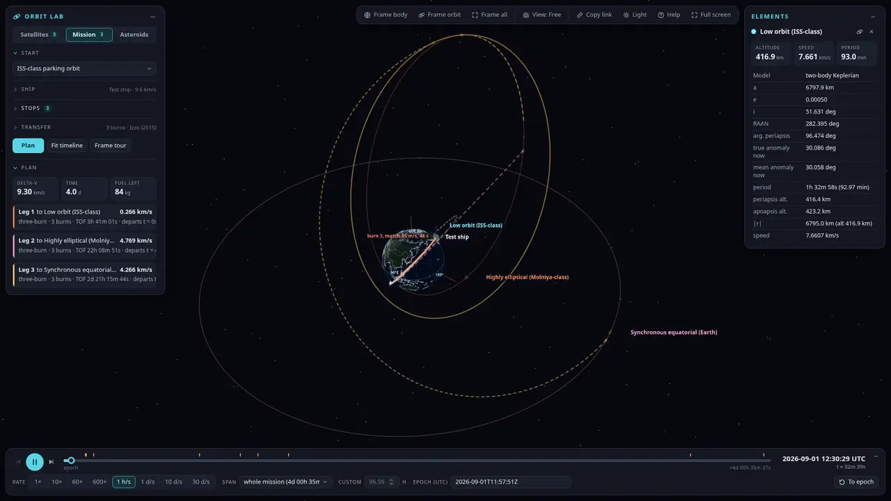</td>
<td width="50%">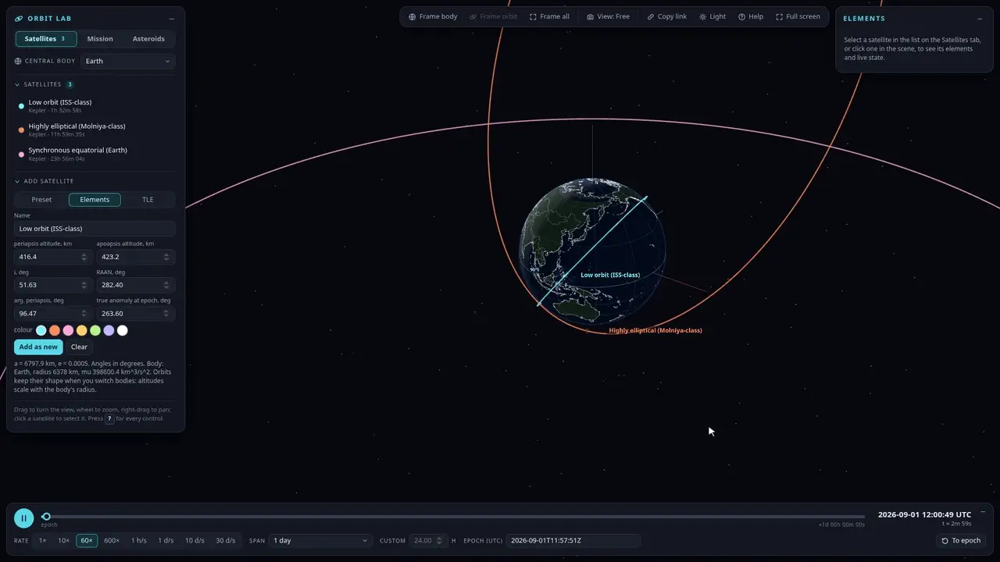</td>
</tr>
<tr>
<td><b>A tour playing.</b> Three stops, three burns each, one hour a second.</td>
<td><b>Pick in the scene.</b> Hover, click to select, double-click to fly to an orbit.</td>
</tr>
<tr>
<td width="50%">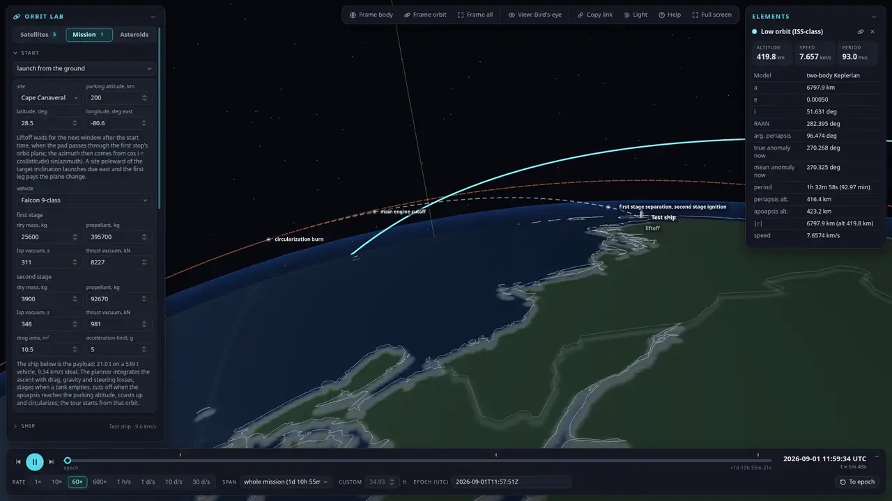</td>
<td width="50%">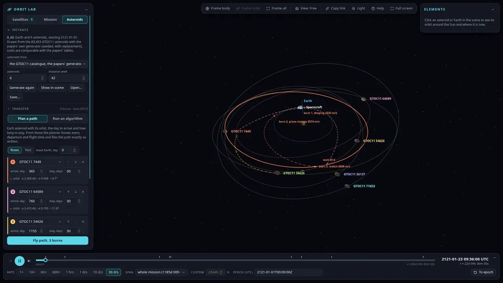</td>
</tr>
<tr>
<td><b>Launch from the ground.</b> Cape Canaveral, from liftoff through the gravity turn.</td>
<td><b>Asteroid routes.</b> A hand-written path through a GTOC11 instance.</td>
</tr>
</table>

## How to use

Open <https://openspacepath.vercel.app>. Nothing needs an account or a key. The page has a 3D scene in the middle with panels around it:

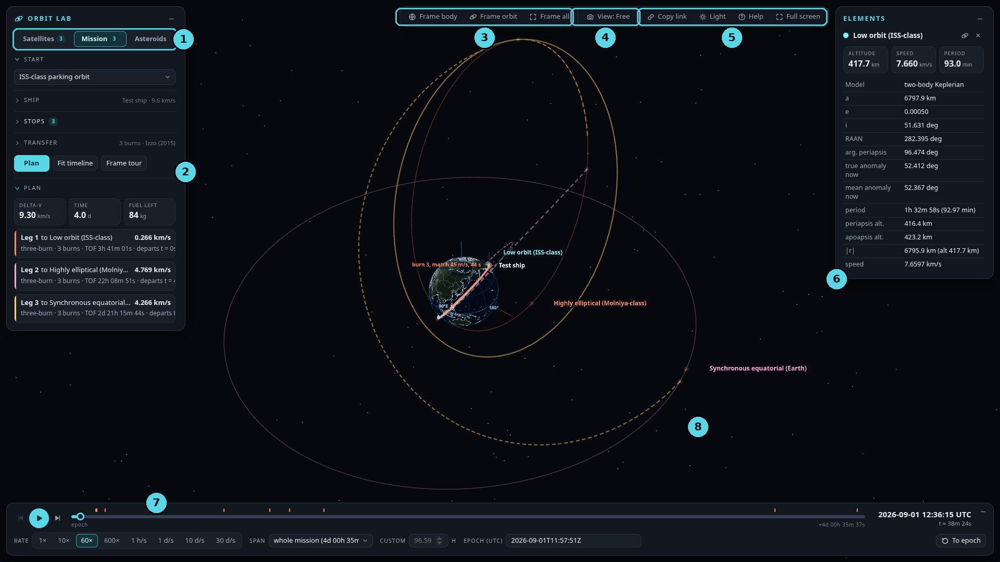

1. **Tabs.** Satellites builds the scene, Mission plans a tour between satellites, Asteroids works with asteroid instances.
2. **The tab's controls.** Everything for the open tab. Sections fold away and keep a one-line summary.
3. **Framing.** Frame body (home), Frame orbit (the selected one) and Frame all. The camera flies there and fits the part of the window the panels leave free.
4. **View menu.** The camera mode, and what the scene draws: labels, axes, the path still to fly, burn labels, and Hide panels.
5. **Page.** Copy link, light or dark theme, Help (every control) and full screen.
6. **Elements.** The selected object's orbit and where it is now, with buttons to frame it or clear the selection.
7. **Timeline.** Play and pause, step to the previous or next burn, scrub, and set the rate, the span and the epoch.
8. **The scene.** Drag to turn, scroll to zoom, right-drag to pan. Click a satellite or asteroid to select it, double-click to fly to its orbit.

### Satellites

1. Choose the **central body**. Orbits keep their shape when it changes: altitudes scale with the body's radius.
2. Select a satellite in the list, or click it in the scene. Its orbit is highlighted and the Elements panel shows its numbers.
3. Under **Edit or add satellite**, pick **Preset** (ISS-class, GPS, GEO, Molniya, sun-synchronous, areostationary, low lunar orbit), **Elements** (periapsis and apoapsis altitude, inclination, RAAN, argument of periapsis, true anomaly at epoch) or **TLE** (paste two lines; Earth only, propagated with SGP4).
4. **Update** changes the selected satellite; **Add as new** adds another.

<table>
<tr>
<td width="50%">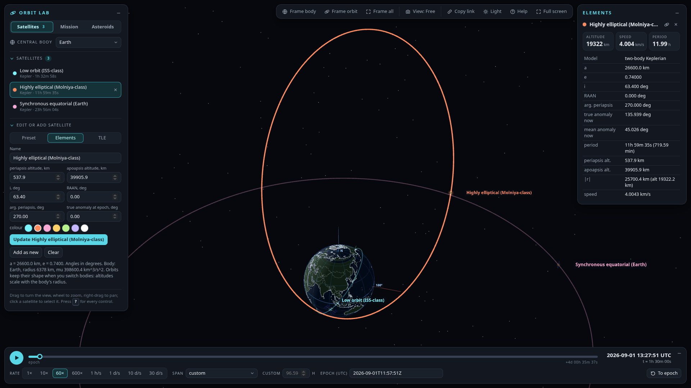</td>
<td width="50%">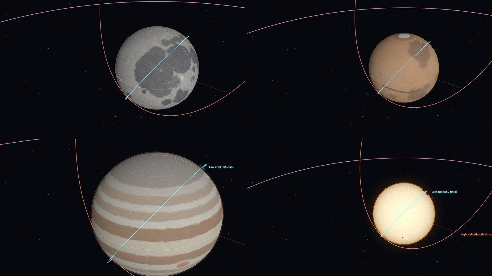</td>
</tr>
<tr>
<td><b>A selected orbit</b>, framed, with its elements on the right.</td>
<td><b>Other bodies</b>: the Moon, Mars, Jupiter and the Sun, drawn from their real features.</td>
</tr>
</table>

### Mission

1. **Start**: an ISS-class parking orbit, riding with one of the satellites, or a launch from the ground (site, vehicle and stages are editable).
2. **Ship**: masses, engine Isp and thrust. The delta-v it can afford shows in the section's summary.
3. **Stops**: add satellites in the order to visit them and how long to stay with each.
4. **Transfer**: two burns (a Lambert arc) or three (shape the orbit, change plane at the node, match the target), and the Lambert solver.
5. Press **Plan**. The planner returns every leg with its burns. The tiles give the total delta-v, time and fuel left. Click a leg to focus it, **Fit timeline** to set the span to the tour, **Frame tour** to see it all.
6. Press play, and pick a camera from the View menu: **Follow** travels with the ship, **Chase** sits behind it, **Bird's-eye** looks straight down on the current leg.

A launch adds the ascent to the tour: liftoff waits for the window when the pad passes through the first stop's plane, the vehicle sheds its stages, and the first leg starts from the parking orbit it reaches.

<table>
<tr>
<td width="50%">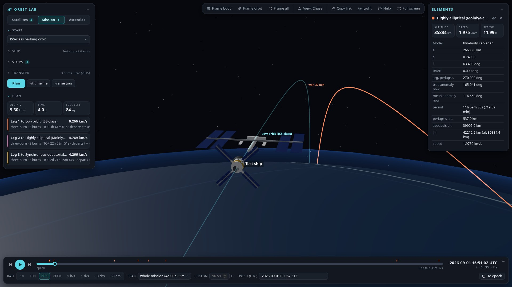</td>
<td width="50%">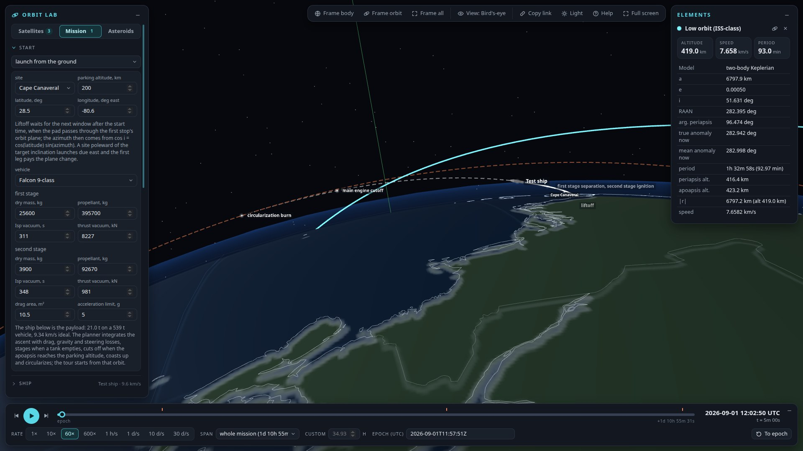</td>
</tr>
<tr>
<td><b>Chase</b>: the ship keeping station with a station-class satellite.</td>
<td><b>A launch</b> from Cape Canaveral, seen from above, with its events marked.</td>
</tr>
</table>

### Asteroids

1. **Instance**: draw *n* asteroids from the GTOC11 catalogue with the papers' own generator (instance `n_seed` is the same one the papers use), or from a synthetic main belt; **Open…** and **Save…** read and write instance files.
2. **Plan a path**: list the asteroids to visit with the day to arrive and the days to stay, as rows or as text, then **Fly path**. The path is flown exactly as written.
3. **Run an algorithm**: start from an example (greedy nearest neighbour, random search, a restricted decision diagram, Peel-and-Bound) or write your own in Python, set the budget and seed, and **Run**. It runs in your browser; only its transfer questions go to the planner. The result shows the cost, the legs, every route tried and how the best cost converged, and the best route flies in the scene.

<table>
<tr>
<td width="50%">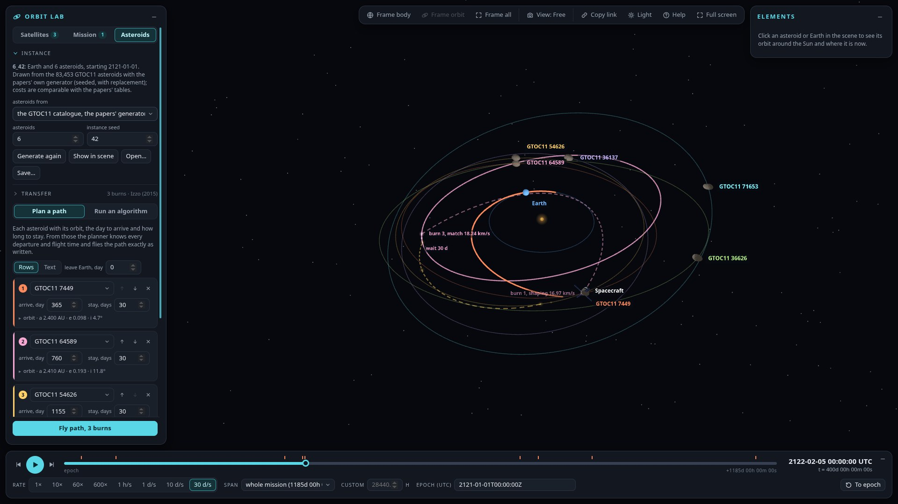</td>
<td width="50%">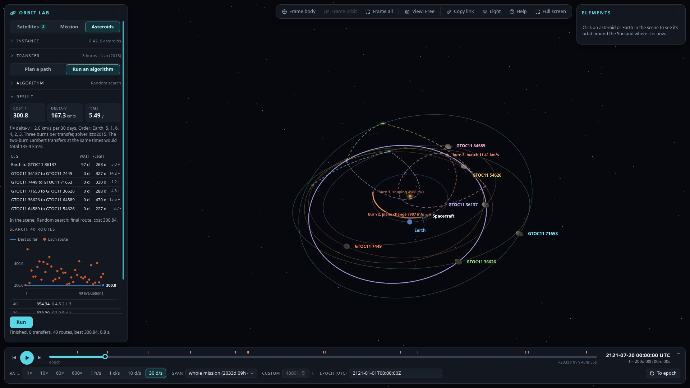</td>
</tr>
<tr>
<td><b>A path</b> through three of six GTOC11 asteroids.</td>
<td><b>An algorithm run</b>: the cost, the legs, the convergence and the best route.</td>
</tr>
</table>

The algorithm format is specified in [research/06_routing_algorithm_format.md](research/06_routing_algorithm_format.md).

### Mouse and keyboard

| Mouse | |
|---|---|
| Drag | Turn the view |
| Right-drag, or Shift + drag | Pan |
| Wheel | Zoom |
| Click a satellite, an asteroid or its name | Select it |
| Double-click it | Select it and fly to its orbit |
| Click empty space | Clear the selection |

| Keys | |
|---|---|
| <kbd>Space</kbd> | Play or pause |
| <kbd>,</kbd> <kbd>.</kbd> | Slower or faster |
| <kbd>[</kbd> <kbd>]</kbd> | Previous or next burn |
| <kbd>1</kbd> <kbd>2</kbd> <kbd>3</kbd> <kbd>4</kbd> | Camera: Free, Follow, Chase, Bird's-eye |
| <kbd>H</kbd> <kbd>F</kbd> <kbd>A</kbd> | Frame the body, the selection, everything |
| <kbd>L</kbd> | Labels on or off |
| <kbd>P</kbd> | Hide or show the panels |
| <kbd>Esc</kbd> | Clear the selection |
| <kbd>?</kbd> | Every control, in the app |

The single-key shortcuts can be switched off in the Help dialog.

## Run it locally

You need Node 22 or later and Python 3.12 (with [uv](https://docs.astral.sh/uv/) the setup is two commands).

```bash
git clone https://github.com/SuryaThirukonda/openSpacepath.git && cd openSpacepath
uv venv --python 3.12 api/.venv && source api/.venv/bin/activate
uv pip install -r requirements.txt -r api/requirements-dev.txt
npm --prefix app install
npm --prefix app run dev:api    # the planner, on port 8000
npm --prefix app run dev        # the app, on port 5173; it proxies /api to the planner
```

Tests: `npm --prefix app test` for the app, `PYTHONPATH=. api/.venv/bin/pytest api/tests -q` for the planner. Python 3.12 is needed because `numba`, which the Lambert solvers use, does not install on newer versions yet.

## How it works

| Part | What it does |
|---|---|
| [`app/`](app/README.md) | Vite, React 19, three.js and zustand. Keplerian and SGP4 propagation, the scene, the panels, the share-link codec. |
| [`api/`](api/README.md) | A FastAPI planner, deployed as one Vercel Python function: Lambert and three-burn rendezvous, launch ascents, and the asteroid-routing transfer model. |
| `app/public/arp-worker.js` | Runs routing algorithms in a Web Worker with Pyodide. |
| [`research/`](research/README.md) | The research behind it: orbital mechanics, frames and SGP4, existing tools, transfers, the routing papers, and the three-burn derivation. |

The physics is stated plainly rather than hidden. Satellites and the ship coast on two-body orbits; burns are impulsive; the launch is a planar ascent with drag and a simple guidance law; each leg arrives exactly where the target's own propagator puts it. The [app's README](app/README.md#fidelity-stated-honestly) lists every simplification.

## Data and credits

- Asteroid orbits: the GTOC11 catalogue as packaged with López-Ibáñez, Chicano and Gil-Merino, *The Asteroid Routing Problem* (2022), [Zenodo 6034335](https://zenodo.org/records/6034335), CC BY 4.0. Exact routing follows Rudich et al., *An Exact Framework for Solving the Space-Time Dependent TSP* (2024).
- Lambert solvers: [lamberthub](https://github.com/jorgepiloto/lamberthub). SGP4: [satellite.js](https://github.com/shashwatak/satellite-js) and [sgp4](https://pypi.org/project/sgp4/).
- Earth map: [Natural Earth](https://www.naturalearthdata.com/) through [world-atlas](https://github.com/topojson/world-atlas), public domain.
- Body radii and gravitational parameters: NASA/JPL fact sheets.

## License

[MIT](app/LICENSE).
