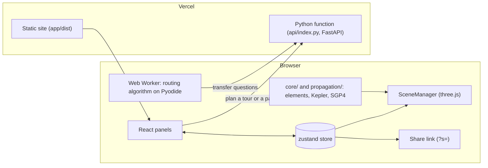

# Orbit Lab design

What Orbit Lab is, how it is put together, and the decisions behind it. The [README](../README.md) is the user guide. [`app/README.md`](../app/README.md) and [`api/README.md`](../api/README.md) describe the code, and the [other documents here](README.md) each go deeper into one part.

## What it is

Orbit Lab is a web app for building orbital scenarios, planning spacecraft tours through them, and watching the tours fly in 3D. It has three tabs over two scenes:

- **Satellites.** A central body (Earth, the Moon, Mars, Venus, Jupiter or the Sun) with satellites defined by their orbital elements, by presets or, around Earth, by a TLE.
- **Mission.** A ship visits satellites in the order given. Each leg is a two- or three-burn rendezvous with the satellite where it will be at arrival, and the tour can begin with a launch from the ground.
- **Asteroids.** The Sun and an instance of the Asteroid Routing Problem. A route can be written by hand and flown, or found by an algorithm written in Python and run in the page.

The Satellites and Mission tabs share the scene around the central body; the Asteroids tab has its own scene centred on the Sun. Each scene keeps its own clock, plan and camera mode.

## How it is put together

- **The browser** draws the scene, propagates the satellites for their markers, keeps time and writes the scenario into the link. `SceneManager` reads the store in its own animation loop and never renders through React.
- **The planner** ([`api/`](../api/README.md)) does the transfer mathematics: Lambert solves, the three-burn rendezvous, launch ascents, tour assembly and the routing problem's transfer model. It runs as one Vercel Python function in the same project as the static site.
- **A plan comes back as dense samples** of every coast and ride. The browser interpolates them, so playing, pausing, scrubbing and changing the rate never call the planner.
- **Routing algorithms run in the visitor's browser**, in a Web Worker on Pyodide. The planner only answers their transfer questions and never runs anyone's code.

The app's source, in `app/src/`:

| Folder | Holds |
|---|---|
| `core/` | Elements, Kepler's equation, time, the Sun's direction |
| `propagation/` | The Keplerian and SGP4 propagators |
| `data/` | Central bodies, presets, ships, launch sites and vehicles, surface features |
| `store/`, `url/` | The zustand store and the share-link codec |
| `mission/` | Mission types, the planner client, the ship's state from the plan's samples |
| `arp/` | The routing format, instances, paths, the algorithm runner and the tab's state |
| `scene/` | The three.js scene: bodies, orbits, markers, labels, camera |
| `ui/` | The React panels |

One rule keeps the layers apart: nothing in `core/`, `propagation/` or `data/` imports from `scene/`, `ui/` or `store/`. The mathematics can be tested without a renderer, and the renderer can be replaced without touching it.

## Decisions

Each decision gives its reason and, where there was one, the alternative set aside.

### Delivery

- **A web page with no install, no account and no keys.** A link opens the same scenario on any laptop or phone, and the repository runs locally for anyone who clones it. *Set aside:* a desktop app, or a hosted service with sign-in.
- **A static site and one Python function, both on Vercel.** The frontend stays static. The transfer mathematics needs Python (below), and Vercel runs Python functions in the same project, so there is one deployment and one domain. *Set aside:* a separate host for the backend.
- **The whole scenario in the link.** The `?s=` parameter carries the scene, the mission inputs and the scene the link was made in, with a schema version so older links still open. Plans are not encoded; they are requested again when a link opens. Instances, paths, algorithms and runs are saved to and opened from files.
- **Never code in a link.** Routing algorithms stay in the browser's local storage and in files. A link that carried code would run it in the browser of whoever opened it.

### Rendering

- **three.js, driven by one `SceneManager`.** three.js is a small rendering library that does its matrix maths in float64 on the CPU, gives full control over lines, points, depth and labels, and calls the app's JavaScript libraries directly. *Set aside:* CesiumJS, whose scene is centred on Earth by construction and cannot hold the asteroid scene around the Sun; Unity, Godot and Unreal, which add megabytes to every page load and put a language bridge between the app and its JavaScript libraries (and, for Unity, a proprietary editor between contributors and the code); React Three Fiber, which would move the scene into React's render cycle for no gain in a scene driven by a store.
- **React panels and one zustand store.** Forms, tables and charts are document UI, not game UI. React and the render loop read the same store.
- **A stylized instrument, with real geography.** A dark scene with clean lines. Earth's map is Natural Earth's country polygons, turned by sidereal time and lit from the Sun's true direction on the scenario's date. The other bodies are drawn procedurally, with named features at their published coordinates and sizes, each flattened by its real oblateness. Vehicles are generic designs in real proportions, drawn at a constant size on screen. *Set aside:* photographic textures, which the look does not need.
- **Flat dark and light themes for the panels**, with no gradients. The scene stays dark in both.

### Computation

- **Transfer mathematics in Python, with `lamberthub`.** One package offers seven Lambert solvers behind one call, SciPy supplies the optimizers, and `sgp4` propagates TLE targets with the same model as the browser. The function, FastAPI included, is about 364 MB, inside Vercel's 500 MB limit for Python. The price is a cold start of a few seconds after an idle period, most of it numba compiling the solvers, so the page calls `/api/health` when it loads to warm the function. *Set aside:* a TypeScript port of Izzo's solver in the browser, which was the first plan; `pykep`, which publishes no Linux wheels on PyPI.
- **The ship's state is a function of the plan.** The planner returns times, positions and velocities along every coast and ride, and the browser interpolates them with cubic Hermite splines. *Set aside:* propagating the ship in the browser, which would need a second copy of the planner's models.
- **Each leg ends where the target's own model puts it.** Targets keep their propagators (two-body, or SGP4 for a TLE). The ship coasts on two-body orbits between impulsive burns, and each leg's endpoint is the target's state at the arrival time, so mixing models adds no mismatch at the rendezvous.
- **Routing algorithms run in the browser.** An algorithm is ordinary sequential Python: it runs in a Web Worker on Pyodide, and each transfer it asks for is a blocking request from the worker to the planner. The server never executes a visitor's code, and Stop ends the worker, so a loop that never finishes cannot hang the page. Python, because the papers' reference code and the transfer model are Python. *Set aside:* running algorithms on the server.

### Transfers

- **The three-burn rendezvous is the default, and the two-burn Lambert rendezvous is a toggle.** The three-burn method follows a derivation sheet, with four documented departures. It wins clearly when a plane change is needed or the arrival time is free, and between fixed times it can cost more than a Lambert arc. See [three-burn-transfer.md](three-burn-transfer.md). *Set aside:* the phasing, bi-elliptic and four-burn waypoint strategies of the first planner, removed when the three-burn method replaced them.
- **A choice of Lambert solver.** Every transfer uses one of `lamberthub`'s seven solvers, Izzo (2015) by default, each with a note on what to expect of it. Answers from the five solvers that are not robust are propagated and rejected when they miss the target. The choice is saved in the link.
- **The user orders the stops.** The planner chooses each leg's timing, not the order of the tour. See [mission-planner.md](mission-planner.md).

### Asteroid routing

- **The papers' own instances.** Instance `n_seed` is drawn from the GTOC11 catalogue with the first paper's generator, so a route's cost can be set beside the papers' tables under the Izzo or Gooding solver; the planner's tests reproduce the published package's results for instance 10_42 to within 1e-4. A synthetic main belt is the second source, named so that it is not mistaken for theirs. [`scripts/gtoc11_catalogue.py`](../scripts/gtoc11_catalogue.py) built `api/data/gtoc11.npz` from the published package without executing any of its code.
- **One format for algorithms.** `ARP-ALGORITHM 1` fixes the conversation between an algorithm and the transfer black box, so any algorithm runs on any instance and can be drawn and compared. See [routing-algorithm-format.md](routing-algorithm-format.md).
- **Transfer times are chosen on the two-burn cost in both modes**, as the papers define them, so a route keeps one deterministic cost and evaluations stay affordable. In three-burn mode those times are then flown with three burns, and the two-burn figure is reported beside the result.

### Orbits and data

- **Orbits from periapsis and apoapsis altitude**, not from a and e. An orbit then stays above the surface, and keeps its shape when the central body changes, because altitudes scale with the body's radius.
- **TLEs only through SGP4.** TLE elements are mean elements fitted to SGP4 and mean nothing outside it; the two-body propagator is for elements entered by hand. The scene treats SGP4's TEME output as its inertial frame (0.37° from J2000 in 2026) and turns Earth by Greenwich mean sidereal time.
- **No fetching from CelesTrak.** The app bundles one ISS element set and takes pasted TLEs. CelesTrak publishes every two hours and refuses repeat downloads with HTTP 403, so the form says to fetch at most that often.

### Interface

- **Conventions from established space viewers.** The camera orbits a focus. Framing moves are animated and can be interrupted. A click selects, a double-click flies to the orbit, and hovering names the object. Labels are placed by priority and never overlap. A help dialog lists every control, and the single-key shortcuts can be switched off. See [interface.md](interface.md).

### Verification

- **Correctness is checked against independent answers, not by eye.** CI runs both test suites, plus the web gates (lint, typecheck, build), on every push. The checks include:
  - known answers: Curtis Examples 4.7 and 5.2, Hohmann transfers and the ISS;
  - cross-checks between libraries: satellite.js against python-sgp4, and `lamberthub`'s solvers against each other and against an independent numpy Izzo solver;
  - every planned leg propagated to its target, within 1 m and 1 mm/s.

## Conventions

- Kilometres, seconds and radians inside the code; degrees only where the UI takes them. The planner adds kilograms and newtons.
- The perifocal-to-inertial rotation is Q = Rz(Ω) Rx(i) Rz(ω).
- In the scene one unit is 1,000 km, and the inertial z axis (the pole) maps to three.js +y through one parent rotation.
- Simulated time is seconds since the scenario's epoch, the same clock in the app and the planner.

The formulas are in [mathematics.md](mathematics.md).

## Fidelity

Satellites entered by their elements coast on two-body orbits, with no J2, drag or third bodies; TLE satellites use SGP4. Burns are impulsive. The launch is a planar ascent with drag and a simple guidance law. Asteroids move on fixed heliocentric Kepler orbits. The [app's README](../app/README.md#fidelity-stated-honestly) lists every simplification.
