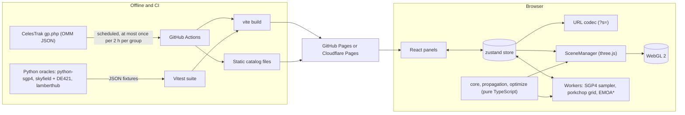
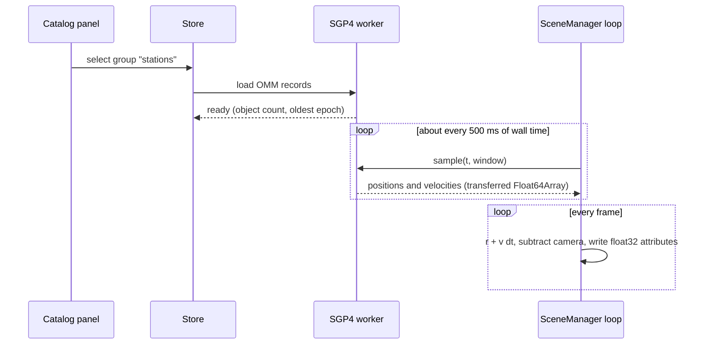
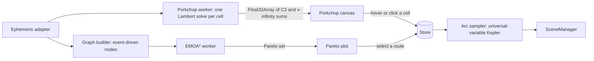

# Orbit Lab System Design

**Document** OSP-SDD-001 · **Revision** A · **Date** 2026-09-14 · **Status** proposed, for review with Prof. Rathinam

This document collects the research, the technology choices and the reasons for them, the system architecture, and the mathematics Orbit Lab needs from Phase 0 through Phase C. It supersedes `03_tech_stack.md`.

> **Amendment 2026-09-22.** The transfer mathematics for the mission-path feature (Lambert rendezvous, multi-burn strategies, ship arithmetic) will run in Python on Vercel functions with `lamberthub`, not as a TypeScript port, per `05_mission_path_plan.md` §12. The static-site decision in §1 and §5.13 now reads: static frontend plus Python functions in the same project; rendering, satellite propagation for markers and URL state stay in the browser.

**Evidence base.** The six track studies, the gap statement and the errata in this folder (research snapshot 2026-09-01); Part III of `../rathinam_project_master.md`; the `app/` code at commit `d0b8eb9`; registry, documentation and repository checks made on 2026-09-07 and 2026-09-14 (listed in §10); and a numerical check of every formula in §7, saved as `scripts/T7_design_math_check.py` with its output.

**Reading order.** §1 is the one-page summary. §4 answers whether a game engine such as Unity or PlayCanvas would be a better base. §7 is the mathematics reference, and §8 records how each formula was checked.

---

## 1. Decisions at a glance

| Concern | Decision | Main reason | Rejected alternatives |
|---|---|---|---|
| Delivery | Static web app. No install, no server. | A link opens a demo on any laptop or phone, which is how every Monday meeting and every shared scenario works. | Desktop app; Unreal Pixel Streaming (needs a GPU server) |
| Language | TypeScript for everything that ships. Python only for offline oracles. | One language for math, UI and workers; the math stays headless-testable. | C# (Unity), GDScript (Godot), a Python service |
| 3D rendering | three.js r185 behind a renderer interface, driven imperatively by `SceneManager`. | Smallest footprint, float64 matrices on the CPU, full control of lines, points and depth, and already working. | Unity 6, Godot 4, PlayCanvas, Unreal (§4); Babylon.js is the named fallback; CesiumJS stays an optional Earth mode |
| Numerical precision | World positions in float64 on the CPU; camera-relative float32 upload; reversed-Z depth. | float32 steps are 16 km at 1 AU and 512 km at 30 AU (§7.18). | Single-precision world coordinates in any engine |
| User interface | React 19 DOM panels with one zustand store. | Forms, tables, the porkchop and the Pareto plot are document UI, not game UI. | Engine UI systems; React Three Fiber |
| Plots | Canvas 2D with `d3-scale`, `d3-scale-chromatic`, `d3-contour`. | About 7 KB gzip for scale plus contour, fully interactive. | Plotly (multi-megabyte, static idiom) |
| Earth-orbit propagation | satellite.js 7.1 (SGP4) inside Web Workers. | Line-by-line Vallado port, 0.055 m from python-sgp4 (Track 2). | `ootk` (AGPL-3.0-or-later), hand-written SGP4 |
| Catalog data | CelesTrak OMM JSON fetched by scheduled CI into static files. | TLE text overflowed at catalog number 100,000; CelesTrak returns HTTP 403 on repeat downloads. | TLE text; live fetches from every browser |
| Planet positions | astronomy-engine 2.1 (truncated VSOP87, stated ±1 arcminute), validated against DE421. | 46 KB gzip, no dependencies, position and velocity in the J2000 equator frame. | spacekit fixed 2018 elements; SPK kernels in the browser (no JavaScript reader exists) |
| Lambert solver | In-house TypeScript port of Izzo (2015), with a universal-variable solver as the test oracle. | Checked here: at most 3 iterations and 1.7e-12 km/s agreement over 4,891 random cases (§8). | Unaudited npm packages as runtime dependencies; a pykep web service |
| Multi-objective search | TypeScript EMOA\*, two objectives (Δv, time of flight) first, sorted-array frontier. | License-clean; Late-BS was fastest in every case in the AIJ 2025 experiments (Track 5). | Vendoring `public_emoa` (no license file) |
| 3D assets | Blender for authoring, glTF 2.0 for interchange, `gltf-transform` for compression. | Every engine loads glTF, so the asset choice never locks the renderer choice. | Engine-specific asset formats |
| Verification | Vitest known-answer tests plus cross-library oracle fixtures in CI. | Correctness is the project's credibility with an ME audience. | Visual inspection |
| Hosting | GitHub Pages or Cloudflare Pages, built and deployed by GitHub Actions. | Static and token-free; no response headers required (§5.13). | Serverless functions; a backend |

---

## 2. Requirements and constraints

### 2.1 Functional scope by phase

| Phase | Capability | State on 2026-09-14 |
|---|---|---|
| 0 | Six classical elements to position; Kepler's equation; animated orbits; element editing; six central bodies; presets; one TLE through SGP4; URL state. | Built, 32 tests passing |
| A | Live satellites from OMM records; ground tracks; catalog groups and search; thousands of objects; element-sandbox teaching mode. | Next |
| B | Heliocentric scene from real ephemerides; log-scale distance toggle; one Earth to Mars Lambert arc with encounter markers. | Planned |
| C | Interactive porkchop linked to the 3D arc; transfer-network graph; EMOA\* Pareto routes linked to 3D; benchmarks and write-up. | Planned |

### 2.2 Non-functional requirements

The identifiers are referenced by the engine criteria in §4.2.

| ID | Requirement |
|---|---|
| NFR-1 | Zero-install web delivery that loads on a laptop and a phone browser. |
| NFR-2 | Every scenario is reproducible from its URL. |
| NFR-3 | MIT-licensed and buildable by any student with free, open tooling. |
| NFR-4 | Correctness checked against independent oracles in CI. |
| NFR-5 | One scene spans LEO (hundreds of km) to the outer planets (30 AU) without visible jitter. |
| NFR-6 | 60 fps with at least 5,000 catalog objects on a laptop GPU; porkchop grid responsive. |
| NFR-7 | No API keys or tokens. `npm install && npm run dev` works for a stranger. |
| NFR-8 | Maintainable by one person at 5 to 6 hours a week; small dependency surface. |
| NFR-9 | Fidelity limits disclosed next to every number shown. |
| NFR-10 | Visually appealing, in a stylized-instrument look rather than photoreal. |

### 2.3 Constraints

- **Data etiquette.** CelesTrak publishes on a 2-hour cadence and, since 2026-03-26, answers repeat downloads of the same query with HTTP 403 (Track 2).
- **Licensing.** `public_emoa` has no license file on any branch, so it is all rights reserved until the professor grants terms in writing (Track 5). KeepTrack and `ootk` are AGPL-3.0-or-later. Stuff in Space has no license.
- **Audience.** The professor is a mechanical engineer who works in SI units and knows the element names. Units, element names and fidelity labels must be exact.
- **Time.** Solo development alongside a full course load; every Monday meeting gets a demo.

---

## 3. Landscape summary

The full evidence is in `gap_statement.md` (30-row comparison) and `track3_existing_projects.md`. The short version:

- **Earth-orbit viewers are polished and do no optimization.** satvis (MIT, CesiumJS, satellite.js) is the architecture bar: SGP4 in a worker pool on an epoch-anchored sample grid, batched primitives for 5,000 to 12,000 satellites above 70 fps, URL state. KeepTrack (AGPL, custom WebGL2) is the performance ceiling at 50,000+ objects.
- **Mission-design tools optimize but have weak or no interactive viewers.** pykep and pygmo (ESA) have no GUI; GMAT (NASA, Apache-2.0) couples single-objective targeting to a legacy OpenGL view; EMTG has no interactive view; poliastro is archived.
- **Four 2026 hobbyist repositories** couple a single-objective Lambert porkchop to a 3D solar system. They have 0 to 3 stars and none does multi-objective search.
- **The defensible gap:** no open-source project couples an exact multi-objective (EMOA\*-class) optimizer to an interactive 3D view, and no mature open-source tool couples any trajectory optimizer to a browser 3D scene.

Two findings from that landscape drive this design directly. Nobody in the genre lets a user edit elements and watch the orbit change, which makes the Phase 0 sandbox a differentiator. And Cesium's scene is Earth-centred by construction, which is why the renderer decision in §4 matters for Phases B and C.

---

## 4. Rendering engine evaluation: would a game engine be better?

### 4.1 Separate the three things "3D" can mean

1. **Modeling** means authoring assets such as spacecraft, planet textures and station meshes. That is Blender's job (free, GPL) no matter which runtime is chosen. Export glTF 2.0, compress with `gltf-transform` (MIT) using meshopt or Draco, and any engine below can load the result. Choosing a game engine is not required to get good 3D models.
2. **The runtime renderer** means drawing lines, points, spheres, textures and labels 60 times a second in a browser. This is the actual decision.
3. **The mathematics** means propagation, frames, ephemerides, Lambert and multi-objective search. It lives in plain TypeScript under `core/`, `propagation/` and `optimize/` in every option, so it can be tested without a renderer.

A game engine bundles an editor, rigid-body physics, animation, audio, input and an asset pipeline. Orbit Lab uses almost none of that. Engine physics is the wrong tool for orbits: it integrates rigid bodies in float32 at a fixed step with a uniform gravity vector, while Orbit Lab propagates analytically with Kepler's equation and SGP4. What Orbit Lab does need is DOM UI (forms, tables, plots), Web Workers, URL state, JavaScript libraries (satellite.js, astronomy-engine, d3) and exact control of precision.

### 4.2 Criteria

| Criterion | Why it matters | NFR |
|---|---|---|
| Web delivery weight and startup | A link must open quickly, including on a phone. | NFR-1 |
| JavaScript ecosystem access | satellite.js, astronomy-engine, d3 and React are JavaScript; crossing a language bridge on every frame costs time and complexity. | NFR-2, NFR-8 |
| Precision range | LEO to 30 AU in one scene. | NFR-5 |
| Open tooling | Any student must be able to clone, build and contribute without a proprietary editor or account. | NFR-3, NFR-7 |
| Headless testability | The math must run in Vitest without the renderer. | NFR-4 |
| Static hosting | No custom response headers, no GPU server. | NFR-1, NFR-7 |
| Fit to content | Many thin lines, point clouds, labels and 2D plots, not characters and physics. | NFR-6, NFR-10 |

### 4.3 Candidates, with facts checked on 2026-09-07 and 2026-09-14

Download sizes were measured on 2026-09-14 by fetching each library's published minified build from jsDelivr and compressing it with gzip level 9. They compare whole prebuilt bundles; a tree-shaken ES-module build of Babylon.js or Cesium would be smaller and was not measured.

**three.js r185** (MIT). A rendering library rather than an engine. `three.module.min.js` is 85 KB gzip; the WebGPU build is 180 KB gzip. `Matrix4.elements` is a plain JavaScript array, so matrix products run in float64 on the CPU before float32 upload. `WebGLRenderer` has both `logarithmicDepthBuffer` and `reversedDepthBuffer` options; the three.js guidance is to use one or the other, and reversed depth keeps early depth testing. Orbit Lab's entire production JavaScript today, React included, is 220 KB gzip.

**Babylon.js 9.26** (Apache-2.0). A full TypeScript engine with an inspector, GUI and physics. The complete UMD build is 1,750 KB gzip. It is the only web engine checked with first-class large-world support: the engine option `useLargeWorldRendering` turns on 64-bit matrix math (`useHighPrecisionMatrix`) and a floating origin that offsets the world, view and projection uniforms so the camera sits at the origin; `useFloatingOrigin` enables it per scene. It was announced as experimental on the Babylon forum ahead of 9.0. Custom shaders must use the standard uniform names to be offset automatically.

**PlayCanvas 2.22** (engine MIT). WebGL2 and WebGPU, usable code-only from npm, with `@playcanvas/react` 0.11 (MIT) and web components. The minified build is 616 KB gzip. Its `Mat4` stores elements in a `Float32Array`, so CPU-side matrix math is single precision and there is no built-in floating origin. The visual Editor is a hosted, proprietary product: the free plan allows public projects and 1 GB of storage, Personal costs 15 USD a month, and Organization costs 50 USD per seat a month. Its strengths are the collaborative editor, Gaussian splats and WebXR, none of which this project needs.

**CesiumJS 1.145** (Apache-2.0). A WGS84 globe with double-precision positions and a clock, usable without an ion token. The full `Cesium.js` build is 1,712 KB gzip before its workers and assets. Its scene is Earth-centred by construction, with no heliocentric origin and no log-scale distance mode (Track 3), so it cannot host Phases B and C.

**Unity 6, Web platform** (proprietary editor). Unity Personal is free under 200,000 USD of annual revenue and funding; the runtime fee was cancelled in September 2024, and the splash screen became optional in Unity 6. Web builds require WebGL 2 and WebAssembly. Supported browsers are desktop Chrome, Firefox, Edge and Safari 15+, with mobile support described as limited to iOS Safari 15+ and Android Chrome. WebGPU was experimental from 6000.1 and was announced as fully supported in 6000.6 on 2026-08-24, in beta at that date. An empty build measured by Aras Pranckevičius on Unity 6.0.23 was 10.7 MB for the default 3D URP template, and about 2 MB after stripping packages, input and UI. C# compiles through IL2CPP to WebAssembly; JavaScript interop goes through `.jslib` plugins, and JavaScript can call C# only through `SendMessage` with no argument, one string or one number. `react-unity-webgl` 10.2 (Apache-2.0) wraps that bridge for React. Transforms are single precision, so a floating origin has to be built by hand. Cesium for Unity lists Web (WebGL and WebGPU) as supported, but requires native multithreading and the matching cross-origin-isolation response headers.

**Godot 4** (MIT). Web export uses the Compatibility renderer, which is WebGL 2 only; Forward+ and Mobile are unavailable on the web, and WebGPU is not implemented. Projects written in C# cannot be exported to the web. Since 4.3, single-threaded export is the default; threaded export needs cross-origin-isolation headers. The 4.3 web `.wasm` is about 40 MB uncompressed and 5 MB with Brotli. Double precision requires compiling the engine and every export template with `precision=double`, and even then 3D shaders emulate double precision with float32, with documented jitter in some features.

**Unreal Engine 5.** No browser target: HTML5 export was removed from the engine at 4.24. The official route to a browser is Pixel Streaming, which renders on a server with an NVIDIA NVENC, AMD AMF or Apple VideoToolbox encoder and streams video. Large World Coordinates make world positions double precision with a default `WORLD_MAX` of 88 million km, marked beta in the documentation.

### 4.4 Comparison

| | three.js | Babylon.js | PlayCanvas | CesiumJS | Unity 6 Web | Godot 4 Web | Unreal 5 |
|---|---|---|---|---|---|---|---|
| Runtime download (gzip) | 85 KB core | 1,750 KB full | 616 KB | 1,712 KB + assets | about 2 to 11 MB | about 5 MB wasm | none (video stream) |
| Runs as a static page | Yes | Yes | Yes | Yes | Yes | Yes, single-threaded | No, needs GPU server |
| Language of the app code | TypeScript | TypeScript | JavaScript or TypeScript | TypeScript | C# with a JavaScript bridge | GDScript (C# not exportable to web) | C++ or Blueprints |
| Calls satellite.js, astronomy-engine, d3 directly | Yes | Yes | Yes | Yes | No, through `.jslib` | No, through JavaScriptBridge | No |
| CPU matrix precision | float64 | float32, float64 with an option | float32 | float64 | float32 | float64 only in a custom build | float64 (desktop) |
| Built-in floating origin | No, about 50 lines | Yes | No | Globe-relative | No | Shader emulation | Yes |
| Heliocentric scene | Yes | Yes | Yes | No | Yes | Yes | Yes |
| Open tooling for contributors | Yes | Yes | Yes, code-only | Yes | No, proprietary editor and account | Yes | Source-available, account required |
| Fits DOM UI and plots | Native | Native | Native | Native | Overlay across a bridge | Overlay across a bridge | No |

### 4.5 Precision is decided on the CPU, in every engine

GPUs render in float32 regardless of engine, so the question is only where the large numbers are subtracted away. The spacing between adjacent float32 values is 16 km at 1 AU expressed in km, 17.8 km at 1 AU expressed in AU, and 512 km at 30 AU; float64 spacing at 30 AU is under a millimetre (§7.18). Two industry precedents show the failure and the fix:

- **Kerbal Space Program** (Unity) shipped a "Deep Space Kraken": far from the coordinate origin, rounding made craft parts misalign and break apart. It was fixed with "Krakensbane", which makes the active vessel the origin and moves the universe around it. That is a floating origin.
- **Babylon.js 9 and Unreal 5** now build the same idea in: double-precision math on the CPU, and camera-relative values on the GPU.

Orbit Lab gets the same result in three.js with a small amount of code, because three.js already does matrix math in float64. Keep every world position in float64 in Orbit Lab's own data structures, and each frame set every object's position to its world position minus the camera's world position, with the camera held at the origin (§7.18).

### 4.6 When a game engine would be the right call

- A desktop or VR planetarium where install size does not matter and photoreal lighting does.
- A cinematic trailer or mission animation rendered offline.
- A team whose artists already work in the Unity or Unreal editor.
- A future companion app, such as a Quest build of a finished Pareto route, which could reuse the same TypeScript math exported as JSON.

None of these is a Phase 0 to C requirement.

### 4.7 Verdict

**Keep three.js.** A game engine would work for the pictures, but it would move the project's value, the TypeScript math and the DOM tools around it, to the far side of a language bridge, add megabytes to every link, and in Unity's case put a proprietary editor between students and the code. Precision, the one real technical argument for an engine, is solved the same way in all of them and costs little in three.js.

**Named fallbacks, with triggers.**

- **Babylon.js**, if the floating origin, inspector and material system become more work to own than the extra bundle weight. The math modules move unchanged.
- **CesiumJS as an Earth mode**, if the professor wants a photoreal globe with imagery for Phase A. It would sit behind the renderer interface next to the three.js heliocentric scene.
- **Unity or Unreal**, only for a separate desktop or VR companion, never as the main web app.

**Precedent.** NASA Eyes on the Solar System launched in 2010 as a Unity application that required an install, and later moved to the browser (Track 3).

---

## 5. System architecture

### 5.1 Context



Everything that runs in the browser is static files. Everything that needs a schedule or Python runs in CI or on the developer's machine and produces files.

### 5.2 Module layout and the dependency rule

Existing directories are unmarked; new ones are marked with the phase that adds them.

```
app/src/
  core/          constants, elements, kepler, time; frames (A), units
  propagation/   keplerPropagator, sgp4Propagator; ephemeris adapter (B)
  optimize/      lambert Izzo (C1), lambertUV oracle (C1), porkchop (C1), graph (C2), emoa (C2)
  data/          bodies, presets; catalog loader and OMM parsing (A)
  workers/       sgp4.worker (A), porkchop.worker (C1), emoa.worker (C2)
  store/         zustand store and selectors
  url/           scenario codec, versioned (A)
  scene/         SceneManager, renderer interface, floating origin (B), layers
  ui/            React panels; porkchop canvas (C1), Pareto plot (C2)
app/tests/       known-answer tests and oracle fixtures
```

**Rule.** `core/`, `propagation/`, `optimize/` and `data/` import nothing from `scene/`, `ui/` or `store/`. `workers/` import only those four. This keeps every formula in §7 runnable in Vitest and in a worker without a DOM, and it is what makes the renderer swappable (§4.7). Enforce it with a test that scans import statements, since it is cheap and linter-independent.

### 5.3 State and data flow

- **One store.** The zustand store holds the serializable scenario (central body, epoch, satellites, span, rate), the simulation time `t`, selection and view toggles. React panels subscribe to it. `SceneManager` reads it inside its own `requestAnimationFrame` loop and never goes through React, which is how `app/` already works.
- **URL.** Scenario changes are debounced by 300 ms and written with `history.replaceState` (existing). Add a `v` version field before Phase A changes the schema, and reject unknown versions with a readable message.
- **Workers.** Request and response messages only, with results sent as transferable `Float64Array` or `Float32Array` buffers. No `SharedArrayBuffer`, because it requires cross-origin-isolation headers that static hosts such as GitHub Pages cannot set.



### 5.4 Time model

- The scenario stores its epoch as an ISO 8601 UTC string, and simulation time `t` as float64 seconds since that epoch. The absolute instant is `epochMs + 1000 t`.
- JavaScript `Date` objects are created only at the satellite.js boundary, always from milliseconds, never from local-time strings.
- GMST uses UTC in place of UT1. The resulting error is about 45 m at ISS altitude (Track 2), below one pixel at any regional zoom.
- Julian dates, time scales and GMST are defined in §7.10.

### 5.5 Frames and units at each boundary

| Module | Frame | Units |
|---|---|---|
| `core/kepler`, `keplerPropagator` | Body-centred inertial, z along the body's pole, x toward its reference direction | km, km/s, rad |
| `sgp4Propagator` | TEME (true equator, mean equinox of date) | km, km/s |
| `core/frames` (A) | TEME to Earth-fixed to geodetic | km, rad |
| Ephemeris adapter (B) | Heliocentric, J2000 mean equator (astronomy-engine's EQJ) | AU and AU/day inside the library, km and km/s at the adapter boundary |
| `optimize/lambert` (C1) | Whatever frame the two position vectors share | km, km/s, s |
| `scene/` | three.js world, y up; the inertial z axis maps to +y through one parent rotation (existing); camera-relative from Phase B | 1 scene unit = 1,000 km today |
| `ui/` | Displayed values | degrees, km, minutes, UTC dates |

The two historic bug classes in this genre are frames and units (Track 2). Converting only at these boundaries, and testing each boundary with a known answer, is the defence.

### 5.6 Scene and precision strategy

- **Two viewing modes, one renderer.** Body-centred mode is today's app. Heliocentric mode (B) centres the Sun and places planets from the ephemeris adapter. Both use the same `SceneManager`.
- **Floating origin (B).** World positions live in float64 in Orbit Lab's own objects. Each frame the camera stays at the three.js origin, and every object's position is set to its world position minus the camera's world position (§7.18). Orbit lines are stored relative to their focus body, where local coordinates are small, and placed by the focus body's camera-relative offset.
- **Depth.** Use `reversedDepthBuffer` with a float depth target. Fall back to `logarithmicDepthBuffer` only where reversed depth is unavailable, and never combine them.
- **Scale modes.** True scale, plus a compressed radial scale for heliocentric overviews, labelled "not to scale" whenever it is on (§7.18). Bodies get a minimum pixel size so they never vanish.
- **Catalog objects (A).** One `THREE.Points` draw with per-vertex colour and size attributes, the pattern KeepTrack and Stuff in Space use, re-implemented rather than copied. Orbit lines only for selected, hovered or grouped objects, sampled uniformly in eccentric anomaly (§7.7). Labels as DOM overlays capped near 40 on screen, with "dim, don't hide" for non-matching objects.
- **Lines.** Thin `Line` for dense sets; `Line2` with `LineMaterial` from the three.js addons when pixel-width lines are needed for the selected orbit or a transfer arc.

### 5.7 Catalog pipeline (A)

1. A scheduled GitHub Actions workflow requests each configured group once per run, for example `gp.php?GROUP=stations&FORMAT=JSON`, no more often than every 2 hours, and stops on any non-200 response.
2. It writes `catalog/<group>.json` with the fetch time, and the site build publishes the files. The repo also keeps a vendored snapshot so offline development works.
3. The browser loads the static file, parses OMM records with `json2satrec`, and hands them to the SGP4 worker.
4. The UI shows a staleness notice when an element set is older than its class threshold. Track 2 gives the scale: LEO reaches one globe pixel of error (about 12.7 km) in 3 to 4 days, GEO in 1 to 3 weeks.

### 5.8 Ephemeris adapter (B)

- `planetState(body, instant)` returns heliocentric position and velocity in km and km/s in the J2000 equator frame, converted from astronomy-engine's AU and AU/day (§7.13).
- Results are cached per frame; one scene needs about ten bodies.
- A Vitest fixture compares the adapter with DE421 states exported by skyfield over 2026 to 2030. Accept if position error stays within the stated 1 arcminute, about 44,000 km at 1 AU, and confirm the porkchop minimum from `scripts/T4_3_porkchop.csv` moves by less than 1% in C3 before any mission number is shown from the browser.

### 5.9 Optimization pipeline (C)



- **Porkchop (C1).** Departure dates by time of flight, one Lambert solve per cell (§7.15), costs per §7.16. The grid runs in a worker and returns typed arrays. Hovering a cell draws that arc; clicking pins it for comparison.
- **Arc rendering.** A Lambert solution is a departure state. Sample the arc by propagating that state with universal-variable Kepler propagation (§7.15) and draw it relative to the Sun.
- **Graph and EMOA\* (C2).** The builder emits plain `{ nodes, edges: [{ u, v, cost: [dv, tof] }] }`. The solver sits behind that interface, so a TypeScript EMOA\*, a WASM build of `public_emoa` (if licensed) or a Python service can be swapped without touching the UI (§7.17).

### 5.10 Performance budgets

| Item | Budget | Basis |
|---|---|---|
| Initial JavaScript, gzip | At most 400 KB; porkchop and EMOA\* code split into lazy chunks | 220 KB measured for today's production build on 2026-09-14 |
| Frame time | 16.7 ms; scene update at most 4 ms on the main thread with 5,000 objects | NFR-6 |
| SGP4 | Worker tick near 2 Hz with per-frame extrapolation | 1.6 µs per object per call near epoch, 25 ms for a 15,151-object pass (research benchmark `T3_3_sgp4_bench.mjs`); extrapolation error about 1 m for the ISS over 0.5 s (Track 3) |
| Lambert per porkchop cell | At most 3 Householder iterations | Measured over 4,891 random cases (§8) |
| Porkchop grid | Under 1 s for 6,479 cells in a worker | Target to benchmark in C1; grid size from `T4_3_porkchop.py` |

### 5.11 Verification strategy

- **Known-answer tests** for every formula in §7, using the anchors in §8.
- **Cross-library fixtures** generated offline: satellite.js against python-sgp4 (target under 1 m), the Lambert port against the universal-variable oracle, `lambert-izzo` and the DE421 porkchop CSV, the ephemeris adapter against DE421.
- **Property tests:** elements to state and back (§7.6), Kepler's equation over the whole (M, e) grid (§7.4), Lambert solutions propagated to the target (§8).
- **Weighted-sum regression test:** the three-point example in §7.17 must return B from EMOA\* and never from a weight sweep.
- **Import-rule test** from §5.2.
- **Golden screenshots** with Playwright once the scene stabilises.
- CI gates on typecheck, lint, tests and build before any deploy.

### 5.12 Build and deploy

- `vite build` with `base: './'` (existing) produces a folder that works from any static host or a file server.
- GitHub Actions runs the CI gates, deploys the site, and runs the catalog schedule from §5.7.
- Code splitting: the porkchop and EMOA\* modules load on first use.

### 5.13 Security, privacy and etiquette

- No API keys, tokens or secrets in the client or the repository.
- No analytics by default.
- No `SharedArrayBuffer`, no threads that need cross-origin isolation, so no custom headers are required. GitHub Pages does not let a site set response headers, which by itself rules out threaded Godot exports and the Cesium for Unity web configuration on that host.
- CelesTrak is contacted only by CI, within its published cadence.

---

## 6. Technology stack

### 6.1 Shipped in the browser

| Layer | Package | Version | License | Size, gzip | Role and reason |
|---|---|---|---|---|---|
| Language | TypeScript | 6.0 | Apache-2.0 | build time | Types at the unit and frame boundaries in §5.5. |
| Build | Vite | 8.2 | MIT | build time | Native ES-module workers already configured; fast dev server. |
| UI | React | 19.2 | MIT | in the 220 KB app bundle | Panels, forms and tables; already in place. |
| State | zustand | 5.0 | MIT | about 1 KB | One store read by React and by the render loop without re-rendering the canvas. |
| 3D | three | 0.185.1 | MIT | 85 KB core | Renderer, `OrbitControls`, `Line2`, `CSS2DRenderer`; float64 matrices (§4.3). |
| Earth-orbit propagation | satellite.js | 7.1.0 | MIT | small | SGP4, `json2satrec`, GMST and geodetic helpers; Vallado port. |
| Planet ephemerides (B) | astronomy-engine | 2.1.19 | MIT | 46 KB | VSOP87 states, J2000 equator frame, no dependencies. |
| Plots (C) | d3-scale, d3-scale-chromatic, d3-contour | 4.x | ISC | about 7 KB for scale and contour | Porkchop and Pareto plots on Canvas 2D. |
| Workers | Web Workers via Vite | platform | none | none | `comlink` (Apache-2.0) is an optional convenience, not required. |
| Lambert and EMOA\* (C) | in-house `optimize/` | none | MIT (this repo) | small | §7.15 and §7.17; auditable and license-clean. |

### 6.2 Development, verification and content

| Purpose | Tool | License | Notes |
|---|---|---|---|
| Unit and oracle tests | Vitest 5 | MIT | 32 tests today. |
| Lint | oxlint 1.81 | MIT | Existing. |
| Browser tests | Playwright | Apache-2.0 | Golden screenshots once the scene stabilises. |
| Lambert cross-check | `lambert-izzo` 2.0.0 (dev only) | MIT OR Apache-2.0 | Rust Izzo solver compiled to WASM; 1 star, so used as an oracle only. |
| Lambert reading reference | `influenceth/lambert-orbit` | MIT | One 10 KB JavaScript file implementing Izzo 2015; read, not installed. |
| SGP4 oracle | python-sgp4 2.27 | MIT | Offline fixture generation. |
| Ephemeris and frame oracle | skyfield with DE421, jplephem | MIT | Offline fixtures; DE421 valid 1899 to 2053. |
| Lambert oracle | lamberthub | GPL-3.0 | Offline only, never bundled. |
| Trajectory reference | pykep | MPL-2.0 | Reference implementation of Izzo; C++ with Python bindings. |
| Evolutionary comparison (C3) | pygmo | GPL or LGPL family (Track 3) | Benchmarks for the paper, offline. |
| Numerics | numpy | BSD-3-Clause | Offline scripts, including `T7_design_math_check.py`. |
| 3D assets | Blender, glTF 2.0, `gltf-transform` | GPL (tool only), open standard, MIT | Author, export, compress with meshopt or Draco. |
| CI and hosting | GitHub Actions; GitHub Pages or Cloudflare Pages | service | Static deploys and the catalog schedule. |

### 6.3 Held in reserve

| Package | License | Trigger |
|---|---|---|
| CesiumJS 1.145 | Apache-2.0 | Professor asks for a photoreal Earth with imagery in Phase A (§4.7). |
| Babylon.js 9 | Apache-2.0 | Owning the floating origin, inspector or materials in three.js costs more than the bundle weight (§4.7). |
| `public_emoa` via WASM | none today | The professor grants written license terms (Track 5). |

### 6.4 Do not use

| Item | Reason | Source |
|---|---|---|
| spacekit.js as a base | three r0.135 on WebGL1, fixed 2018 planetary elements (Saturn 0.38° off by 2026), float32 AU coordinates | Track 3 |
| poliastro, hapsira | Archived in 2023; fork dormant | Track 3 |
| KeepTrack source or `ootk` | AGPL-3.0-or-later, confirmed for both | Track 3; npm, 2026-09-07 |
| Stuff in Space original source | No license file | Track 3 |
| TLE text as the ingestion format | Five-digit catalog field overflowed on 2026-07-11 | Track 2 |
| A Cesium ion token in the default build | Breaks a clean clone for strangers | Track 3 |
| `SharedArrayBuffer` | Needs cross-origin-isolation headers | §5.13 |
| React Three Fiber | Moves the scene into React's render cycle for no gain here | §4 |
| Plotly in the app bundle | Multi-megabyte, static-plot idiom | §6.1 |
| Unity, Godot or Unreal as the main app | §4.4 and §4.7 | §4 |

---

## 7. Mathematics reference

Every formula here is either already implemented in `app/src/core/` or is needed by a later phase. Section §8 records how each was checked. Vectors are bold, $\lVert\cdot\rVert$ is the Euclidean norm, and angles are in radians unless marked.

### 7.1 Conventions and constants

- Units inside the math modules are km, s and rad. Degrees exist only at the UI boundary.
- Rotation matrices are active: $R_z(\theta)$ rotates a vector by $+\theta$ about $z$.

| Symbol | Value | Use |
|---|---|---|
| Earth gravitational parameter, WGS-84 | 398,600.4418 km³/s² | Keplerian pipeline |
| Earth gravitational parameter inside SGP4, WGS-72 | 398,600.8 km³/s² | Only inside satellite.js |
| Earth equatorial radius | 6,378.137 km | Altitudes, geodetic conversion |
| WGS-84 flattening | 1/298.257223563 | Geodetic conversion, with eccentricity squared $e_\oplus^2 = f(2-f)$ |
| Earth J2 | 1.08262668 × 10⁻³ | Secular rates, §7.8 |
| Earth rotation rate | 7.2921159 × 10⁻⁵ rad/s | Frames, ground tracks |
| Sidereal day | 86,164.0905 s | Synchronous orbits |
| Sun gravitational parameter | 1.32712440018 × 10¹¹ km³/s² | Heliocentric transfers |
| Astronomical unit | 149,597,870.7 km | Ephemeris conversion |
| 1 AU/day | 1,731.456837 km/s | Ephemeris velocity conversion |
| Obliquity of the ecliptic, J2000 | 23.4392911° | Ecliptic to equator rotation |
| TAI − UTC | 37 s | Time scales |
| TT − TAI | 32.184 s | Time scales |
| J2000 epoch | JD 2,451,545.0 | GMST, ephemerides |
| Mars gravitational parameter, radius | 42,828.375214 km³/s², 3,396.19 km | Capture examples (`data/bodies.ts`) |

### 7.2 The two-body problem

$$
\ddot{\mathbf r} = -\frac{\mu}{r^{3}}\,\mathbf r
$$

Angular momentum and specific energy are conserved:

$$
\mathbf h = \mathbf r \times \mathbf v, \qquad \varepsilon = \frac{v^{2}}{2} - \frac{\mu}{r} = -\frac{\mu}{2a}
$$

which gives the vis-viva equation, the starting point of every speed and Δv in this document:

$$
v^{2} = \mu\left(\frac{2}{r} - \frac{1}{a}\right)
$$

**Fidelity note.** Orbit Lab's Keplerian satellites use only this model: no J2, drag or third bodies. That is stated in the app README and must stay visible in the UI.

### 7.3 Conic geometry and shape from altitudes

$$
r = \frac{p}{1 + e\cos\nu}, \qquad p = a\,(1-e^{2}) = \frac{h^{2}}{\mu}, \qquad r_p = a(1-e), \qquad r_a = a(1+e)
$$

Orbit Lab defines orbits by periapsis and apoapsis altitude above the surface so they stay valid when the central body changes (`shapeFromAltitudes`, `rescaleToBody`):

$$
r_p = R + h_p, \qquad r_a = R + h_a, \qquad a = \frac{r_p + r_a}{2}, \qquad e = \frac{r_a - r_p}{r_a + r_p}
$$

A synchronous orbit has the period of the body's rotation $T_{\mathrm{rot}}$:

$$
a_{\mathrm{sync}} = \left(\mu\left(\frac{T_{\mathrm{rot}}}{2\pi}\right)^{2}\right)^{1/3}
$$

For Earth with the sidereal day this is 42,164.17 km, an altitude of 35,786.03 km and a speed of 3.0747 km/s. Using 86,400 s instead costs 77 km (Track 1).

### 7.4 Position in time: Kepler's equation

$$
n = \sqrt{\frac{\mu}{a^{3}}}, \qquad T = \frac{2\pi}{n}, \qquad M = M_0 + n\,(t - t_0)
$$

$$
M = E - e\sin E
$$

There is no closed-form inverse, so solve for the eccentric anomaly $E$ with Newton's method after wrapping $M$ into $(-\pi, \pi]$:

$$
E_{k+1} = E_k - \frac{E_k - e\sin E_k - M}{1 - e\cos E_k}
$$

**Seed.** Use Vallado's: $E_0 = M - e$ when $-\pi < M < 0$, otherwise $E_0 = M + e$. In this document's check over 7,600 cases with $e \in [0.9, 0.9999]$, it never failed; $E_0 = \pi$ failed in 318 cases and $E_0 = M$ in 20. Track 1 found the same ranking on a different grid (6.7% and 0.7 to 0.8% failures). Stop when $\lvert\Delta E\rvert < 10^{-12}$, capped at 60 iterations.

Converting between anomalies with quadrant-safe `atan2`, as `core/kepler.ts` does:

$$
\nu = 2\,\mathrm{atan2}\!\left(\sqrt{1+e}\,\sin\tfrac{E}{2},\; \sqrt{1-e}\,\cos\tfrac{E}{2}\right), \qquad
E = 2\,\mathrm{atan2}\!\left(\sqrt{1-e}\,\sin\tfrac{\nu}{2},\; \sqrt{1+e}\,\cos\tfrac{\nu}{2}\right), \qquad
r = a\,(1 - e\cos E)
$$

**Hyperbolic arcs (Phase C).** Departure and flyby legs are hyperbolic, with $a<0$:

$$
M_h = e\sinh F - F, \qquad n_h = \sqrt{\frac{\mu}{(-a)^{3}}}, \qquad \tanh\frac{F}{2} = \sqrt{\frac{e-1}{e+1}}\,\tan\frac{\nu}{2}
$$

### 7.5 Elements to state vector

Perifocal frame (P toward periapsis, Q 90° ahead in the orbit plane, W along $\mathbf h$):

$$
\mathbf r_{PQW} = r\begin{bmatrix}\cos\nu\\ \sin\nu\\ 0\end{bmatrix}, \qquad
\mathbf v_{PQW} = \sqrt{\frac{\mu}{p}}\begin{bmatrix}-\sin\nu\\ e + \cos\nu\\ 0\end{bmatrix}
$$

Rotate into the body-centred inertial frame with the 3-1-3 sequence from the professor's lecture:

$$
\mathbf r = Q\,\mathbf r_{PQW}, \qquad \mathbf v = Q\,\mathbf v_{PQW}, \qquad Q = R_z(\Omega)\,R_x(i)\,R_z(\omega)
$$

$$
R_z(\theta) = \begin{bmatrix}\cos\theta & -\sin\theta & 0\\ \sin\theta & \cos\theta & 0\\ 0 & 0 & 1\end{bmatrix}, \qquad
R_x(\theta) = \begin{bmatrix}1 & 0 & 0\\ 0 & \cos\theta & -\sin\theta\\ 0 & \sin\theta & \cos\theta\end{bmatrix}
$$

Written out, with $c$ and $s$ for cosine and sine, exactly as in `perifocalToInertial`:

$$
Q = \begin{bmatrix}
c_\Omega c_\omega - s_\Omega s_\omega c_i & -c_\Omega s_\omega - s_\Omega c_\omega c_i & s_\Omega s_i\\
s_\Omega c_\omega + c_\Omega s_\omega c_i & -s_\Omega s_\omega + c_\Omega c_\omega c_i & -c_\Omega s_i\\
s_\omega s_i & c_\omega s_i & c_i
\end{bmatrix}
$$

**Erratum carried forward.** The master document once wrote $R_z(-\Omega)R_x(-i)R_z(-\omega)$, which places satellites wrongly; the code was always correct (Track 1). **Known answer:** Curtis Example 4.7 ($h$ = 80,000 km²/s, $e$ = 1.4, $i$ = 30°, $\Omega$ = 40°, $\omega$ = 60°, $\nu$ = 30°) gives $\mathbf r$ = (−4039.9, 4814.6, 3628.6) km and $\mathbf v$ = (−10.386, −4.772, 1.744) km/s.

### 7.6 State vector to elements

Needed to show elements for TLE satellites (as osculating values, labelled as such), for Lambert arcs, and for any drag handle that edits an orbit directly.

$$
\mathbf h = \mathbf r \times \mathbf v, \qquad
\mathbf n = \hat{\mathbf k} \times \mathbf h, \qquad
\mathbf e = \frac{1}{\mu}\left[\left(v^{2} - \frac{\mu}{r}\right)\mathbf r - (\mathbf r\cdot\mathbf v)\,\mathbf v\right]
$$

$$
p = \frac{h^{2}}{\mu}, \quad e = \lVert\mathbf e\rVert, \quad a = \frac{p}{1-e^{2}}, \quad i = \arccos\frac{h_z}{h}, \quad \Omega = \mathrm{atan2}(n_y,\, n_x)
$$

$$
\omega = \mathrm{atan2}\!\left((\mathbf n \times \mathbf e)\cdot\hat{\mathbf h},\; \mathbf n\cdot\mathbf e\right), \qquad
\nu = \mathrm{atan2}\!\left((\mathbf e \times \mathbf r)\cdot\hat{\mathbf h},\; \mathbf e\cdot\mathbf r\right)
$$

**Singular cases.** When $e$ is near zero, $\omega$ is undefined: set $\omega = 0$ and measure position from the node with the argument of latitude $u = \mathrm{atan2}((\mathbf n\times\mathbf r)\cdot\hat{\mathbf h},\ \mathbf n\cdot\mathbf r)$. When $i$ is near zero, $\mathbf n$ vanishes: set $\Omega = 0$ and measure $\omega$ from the $x$ axis. Use a tolerance near $10^{-10}$ and say in the UI which convention is active. **Check:** 20,000 random elliptic orbits round-trip through §7.5 and back with a worst error of 5.3 × 10⁻¹³.

### 7.7 Orbit paths and displayed quantities

Sample closed orbits uniformly in eccentric anomaly, as `keplerPathSamples` already does:

$$
\mathbf r_{PQW}(E_k) = \begin{bmatrix} a(\cos E_k - e)\\ a\sqrt{1-e^{2}}\,\sin E_k\\ 0\end{bmatrix}, \qquad E_k = \frac{2\pi k}{N}
$$

Sampling uniformly in time crowds points at apoapsis and starves periapsis: for a GTO with $e$ = 0.73, equal-time steps are 13.1° of true anomaly at perigee against 0.32° at apogee, which shows as a visible kink (Track 3).

Values shown in the elements panel:

$$
v = \sqrt{\mu\left(\frac{2}{r} - \frac{1}{a}\right)}, \qquad
\tan\gamma_{\mathrm{fp}} = \frac{e\sin\nu}{1 + e\cos\nu}, \qquad
h_{\mathrm{alt}} = r - R
$$

where $\gamma_{\mathrm{fp}}$ is the flight-path angle. satvis never shows semi-major axis, period or true anomaly (Track 1), so showing them is part of the teaching differentiator.

### 7.8 J2 secular effects and special orbits

The Keplerian pipeline ignores J2, but these rates define the presets and the "orbit facts" the UI states:

$$
\dot\Omega = -\frac{3}{2}\,n\,J_2\left(\frac{R}{p}\right)^{2}\cos i, \qquad
\dot\omega = \frac{3}{4}\,n\,J_2\left(\frac{R}{p}\right)^{2}\left(5\cos^{2} i - 1\right)
$$

- **Sun-synchronous:** set $\dot\Omega$ equal to 360° per 365.2421897 days and solve for $i$. A 700 km circular orbit needs 98.188°.
- **Critical inclination:** $\dot\omega = 0$ when $5\cos^{2} i = 1$, so $i$ = 63.4349° or 116.5651°. Molniya orbits sit there.
- **ISS nodal regression:** −4.947° per day.
- satvis flags a sun-synchronous orbit when $\dot\Omega$ is within 0.05° per day of the target (Track 3).

### 7.9 Real satellites: SGP4 is a model, not a formula to re-derive

- TLE and OMM elements are **Brouwer mean elements** with a Kozai-convention mean motion, fitted to the SGP4 model itself. They are only meaningful inside SGP4 (satellite.js). Never pass them to §7.5.
- Feeding the ISS TLE to the two-body pipeline is 11.7 km wrong at epoch and grows to roughly 480 km after one day (Track 2).
- OMM fields map to SGP4 inputs: `MEAN_MOTION` in rev/day, `ECCENTRICITY`, `INCLINATION`, `RA_OF_ASC_NODE`, `ARG_OF_PERICENTER` and `MEAN_ANOMALY` in degrees, `BSTAR`, and `EPOCH` in UTC.
- A display-only semi-major axis follows from the mean motion in rad/s with SGP4's own constant: $a = \left(\mu_{\mathrm{WGS72}}/n^{2}\right)^{1/3}$. **Pitfall:** satellite.js's `no` is the Brouwer value after initialisation, while python-sgp4's `no` is the Kozai value (Track 2).
- Element-set error grows with age. For Starlink-class LEO objects the median is about 0.94 km after 6 hours, 2.6 to 4.5 km after 1 day, 11.7 km after 3 days and 38.5 km after 7 days (Track 2). This is what drives the staleness notice in §5.7.

### 7.10 Time

$$
\mathrm{JD} = \frac{t_{\mathrm{Unix,\,ms}}}{86\,400\,000} + 2\,440\,587.5
$$

$$
\mathrm{TAI} = \mathrm{UTC} + 37\ \mathrm{s}, \qquad \mathrm{TT} = \mathrm{TAI} + 32.184\ \mathrm{s}, \qquad \mathrm{UT1} = \mathrm{UTC} + \mathrm{DUT1},\ \ \lvert\mathrm{DUT1}\rvert < 0.9\ \mathrm{s}
$$

Greenwich mean sidereal time, IAU 1982 model, as implemented by satellite.js `gstime`:

$$
T = \frac{\mathrm{JD}_{\mathrm{UT1}} - 2\,451\,545.0}{36\,525}
$$

$$
\theta_{\mathrm{GMST}}\,[\mathrm{s}] = 67\,310.548\,41 + \left(876\,600 \cdot 3600 + 8\,640\,184.812\,866\right)T + 0.093\,104\,T^{2} - 6.2\times10^{-6}\,T^{3}
$$

$$
\theta_{\mathrm{GMST}}\,[\mathrm{deg}] = \left(\frac{\theta_{\mathrm{GMST}}\,[\mathrm{s}]}{240}\right) \bmod 360
$$

**Known answer:** 340.1731699° at 2026-09-01 00:00 UTC. **What time mistakes cost at ISS altitude:** a 1 s propagation slip moves the satellite 7.66 km along track; mistaking TAI for UTC (37 s) moves it 283 km along track, or 17.2 km on the ground if the error enters only through Earth's rotation; a missing `Z` in a date string shifts everything by the local UTC offset, which is thousands of km.

### 7.11 Frames, geodetic coordinates and ground tracks

From SGP4's TEME output to Earth-fixed, rotating by GMST (not apparent sidereal time):

$$
\mathbf r_{\mathrm{ECEF}} = R_z(-\theta_{\mathrm{GMST}})\,\mathbf r_{\mathrm{TEME}}, \qquad
\mathbf v_{\mathrm{ECEF}} = R_z(-\theta_{\mathrm{GMST}})\,\mathbf v_{\mathrm{TEME}} - \boldsymbol\omega_\oplus \times \mathbf r_{\mathrm{ECEF}}
$$

**What frame mistakes cost** (Track 2): skipping the rotation entirely, about 13,394 km; apparent instead of mean sidereal time, about 273 m at LEO; treating TEME as J2000, about 41 km at ISS altitude and about 260 km at GEO in 2026, with no error message.

Earth-fixed to geodetic latitude $\phi$, longitude $\lambda$ and height $h$ on the WGS-84 ellipsoid (semi-major axis $a_\oplus$, eccentricity squared $e_\oplus^{2}$), iterating from $\phi_0 = \mathrm{atan2}(z, \rho)$:

$$
\lambda = \mathrm{atan2}(y,\, x), \qquad \rho = \sqrt{x^{2} + y^{2}}, \qquad
N(\phi) = \frac{a_\oplus}{\sqrt{1 - e_\oplus^{2}\sin^{2}\phi}}
$$

$$
\phi \leftarrow \mathrm{atan2}\!\left(z + N(\phi)\,e_\oplus^{2}\sin\phi,\; \rho\right), \qquad
h = \frac{\rho}{\cos\phi} - N(\phi)
$$

Near the poles use $h = z/\sin\phi - N(\phi)(1 - e_\oplus^{2})$ instead. satellite.js `eciToGeodetic` runs this with a fixed iteration count. The inverse, for a ground station:

$$
\mathbf r_{\mathrm{site}} = \begin{bmatrix}(N + h)\cos\phi\cos\lambda\\ (N + h)\cos\phi\sin\lambda\\ \left(N(1 - e_\oplus^{2}) + h\right)\sin\phi\end{bmatrix}
$$

**Ground-track shift.** Each revolution the track moves west by Earth's rotation plus nodal regression:

$$
\Delta\lambda_{\mathrm{west}} = \left(\omega_\oplus - \dot\Omega\right)T
$$

For the ISS this is 23.308° + 0.319° = 23.627° per orbit, the corrected value from the errata (not 22.5°).

### 7.12 Look angles and coverage

Range vector in Earth-fixed coordinates, rotated into the local south-east-zenith frame of a site at geodetic latitude $\phi$ and longitude $\lambda$:

$$
\boldsymbol\rho = \mathbf r_{\mathrm{sat}} - \mathbf r_{\mathrm{site}}, \qquad
\begin{bmatrix}\rho_S\\ \rho_E\\ \rho_Z\end{bmatrix} =
\begin{bmatrix}
\sin\phi\cos\lambda & \sin\phi\sin\lambda & -\cos\phi\\
-\sin\lambda & \cos\lambda & 0\\
\cos\phi\cos\lambda & \cos\phi\sin\lambda & \sin\phi
\end{bmatrix}\boldsymbol\rho
$$

$$
\mathrm{el} = \arcsin\frac{\rho_Z}{\rho}, \qquad \mathrm{az} = \mathrm{atan2}(\rho_E,\, -\rho_S)
$$

Coverage circle for altitude $h$ and minimum elevation $\mathrm{el}_{\min}$, as an Earth central angle and a ground radius:

$$
\lambda_c = \arccos\!\left(\frac{R}{R + h}\cos\mathrm{el}_{\min}\right) - \mathrm{el}_{\min}, \qquad s = R\,\lambda_c
$$

At 420 km this is 20.25° and 2,254 km with no mask, and 15.83° and 1,762 km with a 5° mask. Track 3 matched a brute-force ISS pass table over College Station against skyfield to within its 10 s step. Azimuth near the zenith is ill-conditioned; show whole degrees or compass points there.

### 7.13 Heliocentric states and ephemerides (Phase B)

- astronomy-engine returns positions in AU and velocities in AU/day in the J2000 mean equator frame. Convert with 1 AU = 149,597,870.7 km and 1 AU/day = 1,731.456837 km/s.
- Lambert transfers around the Sun use heliocentric states with the Sun's gravitational parameter. Barycentric states differ because the Sun itself moves around the barycentre, so subtract the Sun's barycentric state when the library returns barycentric vectors.
- Ecliptic diagrams, such as Curtis-style figures, need a rotation about $x$ by the obliquity:

$$
\mathbf r_{\mathrm{EQJ}} = R_x(\varepsilon_0)\,\mathbf r_{\mathrm{ECL}}, \qquad \varepsilon_0 = 23.439\,291\,1^{\circ}
$$

- **Patched conics.** Inside a planet's sphere of influence use the planet as the central body; outside it use the Sun:

$$
r_{\mathrm{SOI}} = a_p\left(\frac{\mu_p}{\mu_\odot}\right)^{2/5}
$$

Earth's is 924,649 km and Mars's 577,239 km, 0.62% and 0.25% of their own orbit radii. That smallness relative to the planet's own heliocentric distance is the correct justification for patching (Track 4 errata); the ratio to the Earth–Mars distance is not.

### 7.14 Transfers, windows and hyperbolic manoeuvres

**Hohmann transfer** between circular coplanar orbits:

$$
a_t = \frac{r_1 + r_2}{2}, \qquad
\Delta v_1 = \sqrt{\frac{\mu}{r_1}}\left(\sqrt{\frac{2r_2}{r_1 + r_2}} - 1\right), \qquad
\Delta v_2 = \sqrt{\frac{\mu}{r_2}}\left(1 - \sqrt{\frac{2r_1}{r_1 + r_2}}\right), \qquad
t_H = \pi\sqrt{\frac{a_t^{3}}{\mu}}
$$

From a 300 km orbit to GEO this is 2.4257 + 1.4668 = 3.8926 km/s in 5.275 h. Earth to Mars takes 258.9 days, which is 8.5 months, not 8.6.

**Synodic period**, the recurrence of launch windows:

$$
T_{\mathrm{syn}} = \left\lvert\frac{1}{T_1} - \frac{1}{T_2}\right\rvert^{-1}
$$

Earth–Mars is 779.9 days in the circular idealisation; real intervals vary from 764 to 812 days (Track 4).

**Hyperbolic excess speed and launch energy**, relative to the planet's own velocity:

$$
v_\infty = \lVert\mathbf v_{\mathrm{sc}} - \mathbf v_{\mathrm{planet}}\rVert, \qquad C_3 = v_\infty^{2}
$$

**Departure** from a circular parking orbit of radius $r_p$, and **capture** into an orbit with periapsis $r_p$ and eccentricity $e_c$ ($e_c = 0$ for circular):

$$
\Delta v_{\mathrm{dep}} = \sqrt{v_\infty^{2} + \frac{2\mu}{r_p}} - \sqrt{\frac{\mu}{r_p}}, \qquad
\Delta v_{\mathrm{cap}} = \sqrt{v_\infty^{2} + \frac{2\mu}{r_p}} - \sqrt{\frac{\mu\,(1 + e_c)}{r_p}}
$$

For the Earth–Mars Hohmann transfer: departure $v_\infty$ = 2.9448 km/s, $C_3$ = 8.672 km²/s², and 3.5900 km/s from a 300 km orbit. At Mars, $v_\infty$ = 2.6490 km/s costs 2.0699 km/s to capture into a 500 km circular orbit but only 0.9290 km/s into a 500 × 33,000 km ellipse. That factor of two for the same trajectory is why the capture assumption must be a visible UI choice (Track 4).

**Gravity assist.** The flyby hyperbola's eccentricity and the largest possible turn of $\mathbf v_\infty$ for periapsis radius $r_p$:

$$
e_h = 1 + \frac{r_p\,v_\infty^{2}}{\mu}, \qquad \delta_{\max} = 2\arcsin\frac{1}{e_h}
$$

At Venus with a 300 km periapsis, $\delta_{\max}$ is 116.5° at $v_\infty$ = 3 km/s and 71.9° at 6 km/s.

### 7.15 Lambert's problem (Phase C1)

**Problem.** Given two position vectors $\mathbf r_1$, $\mathbf r_2$, a time of flight $\Delta t$, the gravitational parameter, a direction of motion and a number of revolutions, find the velocities $\mathbf v_1$ and $\mathbf v_2$ of the connecting conic. Both formulations below share the chord and semi-perimeter:

$$
c = \lVert\mathbf r_2 - \mathbf r_1\rVert, \qquad s = \frac{r_1 + r_2 + c}{2}
$$

#### 7.15.1 Universal variables (Curtis Algorithm 5.2): the test oracle

Transfer angle for prograde motion:

$$
\cos\Delta\theta = \frac{\mathbf r_1\cdot\mathbf r_2}{r_1 r_2}, \qquad
\Delta\theta \leftarrow 2\pi - \Delta\theta \ \text{ when } (\mathbf r_1 \times \mathbf r_2)_z < 0, \qquad
A = \sin\Delta\theta\,\sqrt{\frac{r_1 r_2}{1 - \cos\Delta\theta}}
$$

Stumpff functions:

$$
C(z) = \begin{cases} \dfrac{1 - \cos\sqrt{z}}{z} & z > 0\\[6pt] \dfrac{\cosh\sqrt{-z} - 1}{-z} & z < 0\\[6pt] \tfrac{1}{2} & z = 0 \end{cases}
\qquad
S(z) = \begin{cases} \dfrac{\sqrt{z} - \sin\sqrt{z}}{(\sqrt{z})^{3}} & z > 0\\[6pt] \dfrac{\sinh\sqrt{-z} - \sqrt{-z}}{(\sqrt{-z})^{3}} & z < 0\\[6pt] \tfrac{1}{6} & z = 0 \end{cases}
$$

Solve $F(z) = 0$ for $z$:

$$
y(z) = r_1 + r_2 + A\,\frac{z\,S(z) - 1}{\sqrt{C(z)}}, \qquad
F(z) = \left(\frac{y(z)}{C(z)}\right)^{3/2} S(z) + A\sqrt{y(z)} - \sqrt{\mu}\,\Delta t
$$

then recover the velocities from the Lagrange coefficients:

$$
f = 1 - \frac{y}{r_1}, \qquad g = A\sqrt{\frac{y}{\mu}}, \qquad \dot g = 1 - \frac{y}{r_2}, \qquad
\mathbf v_1 = \frac{\mathbf r_2 - f\,\mathbf r_1}{g}, \qquad \mathbf v_2 = \frac{\dot g\,\mathbf r_2 - \mathbf r_1}{g}
$$

**Bracketing lesson from this document's check.** For a single revolution the upper limit is $z < 4\pi^{2}$. The lower limit is not $-4\pi^{2}$: fast hyperbolic transfers have roots below it. A bisection that stopped at $-4\pi^{2}$ returned wrong velocities in 31 of 4,891 random cases, missing the target by thousands of km. Expand the lower bracket until $F < 0$, with $y > 0$ when $A > 0$.

#### 7.15.2 Izzo (2015): the production solver

Geometry, direction and non-dimensional time:

$$
\lambda^{2} = 1 - \frac{c}{s}, \qquad T^{\ast} = \sqrt{\frac{2\mu}{s^{3}}}\;\Delta t, \qquad
\hat{\mathbf h} = \frac{\hat{\mathbf r}_1 \times \hat{\mathbf r}_2}{\lVert\hat{\mathbf r}_1 \times \hat{\mathbf r}_2\rVert}
$$

If $\hat h_z < 0$ (a prograde transfer longer than 180°), take $\lambda = -\sqrt{\lambda^{2}}$, $\hat{\mathbf t}_1 = \hat{\mathbf r}_1 \times \hat{\mathbf h}$, $\hat{\mathbf t}_2 = \hat{\mathbf r}_2 \times \hat{\mathbf h}$. Otherwise take $\lambda = +\sqrt{\lambda^{2}}$, $\hat{\mathbf t}_1 = \hat{\mathbf h} \times \hat{\mathbf r}_1$, $\hat{\mathbf t}_2 = \hat{\mathbf h} \times \hat{\mathbf r}_2$. For retrograde motion flip the sign of $\lambda$ and both tangent vectors.

**Time of flight as a function of $x$**, where $-1 < x < 1$ is elliptic and $x > 1$ hyperbolic, in the form that was implemented and checked, for $M$ complete revolutions:

$$
E = x^{2} - 1, \qquad y = \sqrt{1 + \lambda^{2}E}, \qquad g = x\,y - \lambda E
$$

$$
d = \begin{cases} M\pi + \arccos g & E < 0\\[4pt] \ln\!\left(\sqrt{E}\,(y - \lambda x) + g\right) & E > 0 \end{cases}
\qquad
T(x) = \frac{x - \lambda y - d/\sqrt{\lvert E\rvert}}{E}
$$

This is the same curve as Izzo's $T = \dfrac{1}{1-x^{2}}\left[\dfrac{\psi + M\pi}{\sqrt{\lvert 1-x^{2}\rvert}} - x + \lambda y\right]$ with $\cos\psi = xy + \lambda(1-x^{2})$. Near $x = 1$ it loses precision, so use two other forms there:

- For $0.01 < \lvert x - 1\rvert < 0.2$, Lagrange's form with $a = 1/(1 - x^{2})$. For an ellipse, $\alpha = 2\arccos x$, $\beta = 2\arcsin\sqrt{\lambda^{2}/a}$, and $T = a^{3/2}\left[(\alpha - \sin\alpha) - (\beta - \sin\beta) + 2\pi M\right]/2$. For a hyperbola, $\alpha = 2\,\mathrm{arccosh}\,x$, $\beta = 2\,\mathrm{arcsinh}\sqrt{-\lambda^{2}/a}$, and $T = -a\sqrt{-a}\left[(\beta - \sinh\beta) - (\alpha - \sinh\alpha)\right]/2$. In both cases $\beta$ takes the sign of $\lambda$.
- For $\lvert x - 1\rvert < 0.01$, Battin's series with $\eta = y - \lambda x$, $S_1 = (1 - \lambda - x\eta)/2$, $Q = \tfrac{4}{3}\,{}_2F_1(3, 1; \tfrac{5}{2}; S_1)$, and $T = (\eta^{3}Q + 4\lambda\eta)/2$.

Without the Lagrange branch, this document's check saw Householder iteration counts reach 15 in a few cases; with it, the maximum was 3.

**Derivatives and Householder iteration**, with $\delta = T(x_k) - T^{\ast}$ and $y = \sqrt{1 - \lambda^{2}(1 - x^{2})}$:

$$
T' = \frac{3Tx - 2 + 2\lambda^{3}x/y}{1 - x^{2}}, \qquad
T'' = \frac{3T + 5xT' + 2(1 - \lambda^{2})\lambda^{3}/y^{3}}{1 - x^{2}}, \qquad
T''' = \frac{7xT'' + 8T' - 6(1 - \lambda^{2})\lambda^{5}x/y^{5}}{1 - x^{2}}
$$

$$
x_{k+1} = x_k - \delta\,\frac{T'^{2} - \delta\,T''/2}{T'\left(T'^{2} - \delta\,T''\right) + T'''\,\delta^{2}/6}
$$

**Initial guess for zero revolutions**, in the form used by pykep:

$$
T_{00} = \arccos\lambda + \lambda\sqrt{1 - \lambda^{2}}, \qquad T_1 = \tfrac{2}{3}\left(1 - \lambda^{3}\right)
$$

$$
x_0 = \begin{cases}
-\dfrac{T^{\ast} - T_{00}}{T^{\ast} - T_{00} + 4} & T^{\ast} \ge T_{00}\\[8pt]
\dfrac{5}{2}\,\dfrac{T_1\,(T_1 - T^{\ast})}{(1 - \lambda^{5})\,T^{\ast}} + 1 & T^{\ast} \le T_1\\[8pt]
\left(T^{\ast}/T_{00}\right)^{\ln 2/\ln(T_1/T_{00})} - 1 & \text{otherwise}
\end{cases}
$$

**Velocities** from the converged $x$:

$$
\gamma = \sqrt{\frac{\mu s}{2}}, \qquad \rho = \frac{r_1 - r_2}{c}, \qquad \sigma = \sqrt{1 - \rho^{2}}, \qquad y = \sqrt{1 - \lambda^{2} + \lambda^{2}x^{2}}
$$

$$
V_{r1} = \frac{\gamma\left[(\lambda y - x) - \rho(\lambda y + x)\right]}{r_1}, \qquad
V_{r2} = -\frac{\gamma\left[(\lambda y - x) + \rho(\lambda y + x)\right]}{r_2}, \qquad
V_{t1} = \frac{\gamma\sigma(y + \lambda x)}{r_1}, \qquad
V_{t2} = \frac{\gamma\sigma(y + \lambda x)}{r_2}
$$

$$
\mathbf v_1 = V_{r1}\,\hat{\mathbf r}_1 + V_{t1}\,\hat{\mathbf t}_1, \qquad \mathbf v_2 = V_{r2}\,\hat{\mathbf r}_2 + V_{t2}\,\hat{\mathbf t}_2
$$

**Multiple revolutions.** Up to $M_{\max} = \lfloor T^{\ast}/\pi\rfloor$ revolutions are possible, each with two solutions when the time allows. C1 ships the zero-revolution solution and exposes multi-revolution branches later; only $M = 0$ was checked here. **Known answer:** Curtis Example 5.2 ($\mathbf r_1$ = (5000, 10000, 2100) km, $\mathbf r_2$ = (−14600, 2500, 7000) km, 3,600 s, $\mu$ = 398,600) gives $\mathbf v_1$ = (−5.99249, 1.92536, 3.24564) and $\mathbf v_2$ = (−3.31246, −4.19662, −0.38529) km/s from both formulations.

#### 7.15.3 Drawing the arc: universal-variable propagation

A Lambert solution is a state $(\mathbf r_0, \mathbf v_0)$. Sample the arc at times $\Delta t$ along the flight by solving for the universal anomaly $\chi$ with Newton's method, starting from $\chi_0 = \sqrt{\mu}\,\lvert\alpha\rvert\,\Delta t$:

$$
\alpha = \frac{2}{r_0} - \frac{v_0^{2}}{\mu}, \qquad v_{r0} = \frac{\mathbf r_0\cdot\mathbf v_0}{r_0}
$$

$$
\frac{r_0 v_{r0}}{\sqrt{\mu}}\,\chi^{2} C(\alpha\chi^{2}) + (1 - \alpha r_0)\,\chi^{3} S(\alpha\chi^{2}) + r_0\,\chi - \sqrt{\mu}\,\Delta t = 0
$$

$$
f = 1 - \frac{\chi^{2}}{r_0}\,C(\alpha\chi^{2}), \qquad g = \Delta t - \frac{\chi^{3}}{\sqrt{\mu}}\,S(\alpha\chi^{2}), \qquad \mathbf r = f\,\mathbf r_0 + g\,\mathbf v_0
$$

This works for ellipses and hyperbolas alike, so one routine draws every transfer and flyby leg.

### 7.16 Porkchop plots (Phase C1)

For each cell of a grid over departure time $t_d$ and time of flight $\tau$:

1. Take the departure planet's state $(\mathbf r_1, \mathbf v_{P1})$ at $t_d$ and the arrival planet's state $(\mathbf r_2, \mathbf v_{P2})$ at $t_d + \tau$ from the ephemeris adapter.
2. Solve Lambert for $(\mathbf v_1, \mathbf v_2)$ with the Sun's gravitational parameter.
3. Store the costs:

$$
C_3 = \lVert\mathbf v_1 - \mathbf v_{P1}\rVert^{2}, \qquad
v_{\infty,\mathrm{arr}} = \lVert\mathbf v_2 - \mathbf v_{P2}\rVert, \qquad
\Sigma v_\infty = \sqrt{C_3} + v_{\infty,\mathrm{arr}}
$$

- Show a total Δv only together with its parking-orbit and capture assumptions from §7.14. $\Sigma v_\infty$ is a proxy, not a Δv budget.
- Transfers shorter than 180° are Type I and longer ones Type II. Mask cells within a few degrees of 180°, where the transfer plane is undefined.
- **Known answer** from the DE421 grid in `scripts/T4_3_porkchop.py` (209 × 31 cells, no failures): the best 2026 window departs 2026-10-29 and arrives 2027-09-04 after 310 days, with $C_3$ = 9.281 km²/s² and $\Sigma v_\infty$ = 5.625 km/s. The next window departs 2028-11-23. The minimum-$C_3$ cell and the minimum-$\Sigma v_\infty$ cell are different dates, which is itself a two-objective trade-off worth showing.

### 7.17 Multi-objective route search (Phase C2)

**Dominance.** For cost vectors $\mathbf a, \mathbf b \in \mathbb R^{M}$, all minimised:

$$
\mathbf a \preceq \mathbf b \iff a_j \le b_j \ \ \forall j, \qquad \mathbf a \prec \mathbf b \iff \mathbf a \preceq \mathbf b \ \wedge\ \mathbf a \ne \mathbf b
$$

The Pareto set is every path whose cost vector no other path dominates. Notation differs between the professor's papers: SoCS 2022 writes $\succeq$ for "dominates" and AIJ 2025 writes $\prec$ for the same relation (Track 5).

**Why weighted sums are not enough.** A weighted sum solves

$$
\min_{\pi}\ \mathbf w^{\top}\mathbf g(\pi), \qquad \mathbf w \ge \mathbf 0, \quad \textstyle\sum_j w_j = 1
$$

and every minimiser lies on the lower-left convex hull of the attainable cost vectors. A Pareto-optimal point inside that hull, called unsupported, is never the unique minimiser for any weight. **Example:** A = (1, 10), B = (5, 7), C = (10, 1). None dominates another, but the chord from A to C passes through (5, 6.0), below B. Over 2,001 weights, A wins 1,001 times, C wins 1,000 times, and B wins none.

**Graph model.** Nodes are events, a body at a time, built from candidate windows rather than a daily calendar grid. An edge is a Lambert arc from an earlier event to a later one, with the cost vector

$$
\mathbf c(u, v) = \left(\Delta v(u, v),\ t_v - t_u\right), \qquad \mathbf g(\pi) = \sum_{e \in \pi} \mathbf c(e)
$$

- EMOA\* needs additive costs. Departure Δv applies on the first edge. A stopover at an intermediate body costs capture plus departure (§7.14). An unpowered flyby is feasible only when the incoming and outgoing $v_\infty$ have nearly equal magnitude and the angle between them is at most $\delta_{\max}$.
- Because a stopover or flyby cost depends on both the arriving and the departing arc, build the search graph over arc-to-arc transitions (a line graph), so each edge's cost is fixed and additive.
- Size matters: a daily-resolution Earth–Moon–Mars network over two years has about 7,300 to 8,760 nodes and 35,000 to 40,600 arcs, while the event-driven network in Ishimatsu et al. (2016) has 16 nodes and 598 arcs (Track 6).

**Heuristics.** A vector heuristic must be admissible and consistent:

$$
\mathbf h(v) \preceq \mathbf g^{\ast}(v \to \mathrm{goal}), \qquad \mathbf h(u) \preceq \mathbf c(u, v) + \mathbf h(v)
$$

Start with $\mathbf h = \mathbf 0$, which is always admissible. Tighten later with per-body lower bounds such as the cheapest arc into the goal body.

**EMOA\* pruning.** OPEN is ordered lexicographically by $\mathbf f = \mathbf g + \mathbf h$. When a label $\ell$ at vertex $v$ is popped, discard it if some vector in $v$'s frontier $F(v)$ weakly dominates $\mathbf g(\ell)$ on objectives 2 through $M$, or some vector in the goal frontier weakly dominates $\mathbf f(\ell)$ on objectives 2 through $M$. Comparing only objectives 2 onward is valid because the first component never decreases in lexicographic order. Otherwise add $\mathbf g(\ell)$ to $F(v)$ and expand.

For two objectives this collapses to BOA\*'s constant-time test. Keep one scalar per vertex, $g_2^{\min}(v)$, and discard $\ell$ if

$$
g_2(\ell) \ge g_2^{\min}(v) \quad \text{or} \quad f_2(\ell) \ge g_2^{\min}(\mathrm{goal}); \qquad \text{otherwise } g_2^{\min}(v) \leftarrow g_2(\ell)
$$

Frontier size grows quickly with the number of objectives (AIJ 2025 road network NY: 4,396, 17,719 and 34,142 solutions for three, four and five objectives), which is why C2 starts with two.

**Front quality for the C3 comparison** with pygmo and weighted-sum search. For points sorted by increasing $f_1$ and a reference point $\mathbf r$:

$$
\mathrm{HV} = \sum_{k=1}^{n}\left(f_{1,k+1} - f_{1,k}\right)\left(r_2 - f_{2,k}\right), \qquad f_{1,n+1} = r_1
$$

### 7.18 Rendering mathematics

**Floating-point spacing** at magnitude $x$:

$$
\Delta_{32}(x) = 2^{\lfloor\log_2\lvert x\rvert\rfloor - 23}, \qquad \Delta_{64}(x) = 2^{\lfloor\log_2\lvert x\rvert\rfloor - 52}
$$

| Coordinate | float32 step | float64 step |
|---|---|---|
| 1 AU stored in km | 16 km | 3.0 × 10⁻⁸ km |
| 30 AU stored in km | 512 km | 9.5 × 10⁻⁷ km |
| 1 AU stored in AU | 1.19 × 10⁻⁷ AU, which is 17.8 km | 2.2 × 10⁻¹⁶ AU |
| An object 1,000 km from the camera | 6.1 × 10⁻⁵ km, about 6 cm | 1.1 × 10⁻¹³ km |

**Camera-relative rendering.** Subtract in float64, then store the small result in float32:

$$
\mathbf p_{\mathrm{render}} = \mathrm{float32}\!\left(\mathbf p_{\mathrm{world}} - \mathbf p_{\mathrm{camera}}\right)
$$

With the camera held at the origin, the last row of the table is the precision that reaches the screen, whatever the distance from the Sun.

**Depth.** three.js's logarithmic depth writes $d = \log_2(1 + w)/\log_2(1 + f)$ for clip-space $w$ and far plane $f$, which spends precision evenly across orders of magnitude but disables early depth testing. Reversed depth maps the near plane to 1 and the far plane to 0 in a float depth buffer, which pairs float precision with the perspective divide and keeps early testing. Use one, not both.

**Compressed distances for overviews.** Applied radially from the focus body to planet positions and to every sample of every arc, and labelled "not to scale":

$$
r' = \begin{cases} r & r \le r_0\\[4pt] r_0\left(1 + \ln\dfrac{r}{r_0}\right) & r > r_0 \end{cases}
$$

It is continuous with slope 1 at $r_0$, so nothing jumps when a body crosses it; with $r_0$ = 1 AU, Neptune's 30 AU draws at 4.4 AU.

**Pixel scale**, for "visually truthful" thresholds and point-size limits, at distance $D$ with vertical field of view $\theta$ and a viewport $H$ pixels tall:

$$
\text{km per pixel} = \frac{2D\tan(\theta/2)}{H}
$$

Earth filling a 1,000 px view is 12.76 km per pixel, the threshold Track 2 used for staleness. Catalog points use a clamped size $s = \mathrm{clamp}(k/w,\ s_{\min},\ s_{\max})$ pixels so distant objects never vanish; Stuff in Space uses $k$ = 320,000 with limits of 7.5 and 20 px (Track 3).

---

## 8. Verification ledger

"T7" is `scripts/T7_design_math_check.py` and "T7 extra" is `scripts/T7_extra_checks.py`, both run on 2026-09-14 with their outputs saved beside them. Track references point to checks made during the September 1 research.

| Formula | Check | Result | Where |
|---|---|---|---|
| Elements to state (§7.5) | Curtis Example 4.7 | r = (−4039.89, 4814.56, 3628.62) km, v = (−10.386, −4.7719, 1.7439) km/s, matching the book | T7; Track 1 |
| State to elements (§7.6) | 20,000 random elliptic round trips | Worst error 5.3 × 10⁻¹³ | T7 |
| Kepler seed (§7.4) | 7,600 cases, e from 0.9 to 0.9999 | Vallado 0 failures, E₀ = M 20, E₀ = π 318 | T7; Track 1 on another grid |
| Synchronous orbit (§7.3) | Earth, sidereal day | 42,164.17 km, altitude 35,786.03 km, 3.0747 km/s | T7; Track 1 |
| ISS period (§7.4) | a = 6,798.4 km | 92.976 min | T7; Track 2 |
| J2 rates (§7.8) | Critical inclination, 700 km sun-synchronous, ISS regression | 63.4349°, 98.188°, −4.947° per day | T7; Track 1; Track 3 |
| Ground-track shift (§7.11) | ISS | 23.627° per orbit | T7; errata gives 23.5° to 23.6° |
| Julian date and GMST (§7.10) | 2026-09-01 00:00 UTC | 340.1731699°, identical to Track 2 | T7 |
| Earth-fixed velocity (§7.11) | Against a finite difference of rotated positions | 7.7 × 10⁻¹⁰ km/s | T7 extra |
| Geodetic iteration (§7.11) | 111 latitude and height round trips | 7.3 × 10⁻¹² km | T7 extra |
| Frame error sizes (§7.11) | TEME treated as J2000; skipped rotation; sidereal time model | 41 km at LEO, 260 km at GEO; 13,394 km; 273 m | Track 2, not repeated |
| Coverage (§7.12) | ISS at 420 km | 2,254 km with no mask, 1,762 km with a 5° mask | T7; Track 3 pass table matched skyfield |
| Sphere of influence, synodic period, Hohmann time (§7.13, §7.14) | Earth and Mars | 924,649 km; 577,239 km; 779.9 d; 258.9 d | T7; Track 4 had 924,540 km with other mass values |
| Hohmann Δv (§7.14) | 300 km orbit to GEO | 3.8926 km/s in 5.275 h | T7; master document anchor near 3.9 km/s |
| Departure and capture (§7.14) | Earth–Mars Hohmann | 3.5900, 2.0699, 0.9290 km/s | T7; Track 4 had 3.5897, 2.0694, 0.9285 with its constants |
| Flyby turn angle (§7.14) | Venus, 300 km periapsis | 116.5° and 71.9° | T7, formula evaluation only |
| Lambert, both formulations (§7.15) | Curtis Example 5.2 | Both give v₁ = (−5.99249, 1.92536, 3.24564) and v₂ = (−3.31246, −4.19662, −0.38529) km/s | T7; Track 4 |
| Lambert agreement (§7.15) | 4,891 random prograde single-revolution cases | Worst disagreement 1.7 × 10⁻¹² km/s; Izzo converged in at most 3 iterations | T7 |
| Lambert against direct integration (§7.15) | RK4 integration of 300 sampled solutions | Median miss 9 × 10⁻¹⁰ km for both. 7 cases missed by more than 1 m, the same count for both solvers; the worst passes 8.8 km from Earth's centre, and a 10× finer step cut its miss from 704,500 km to 82 km, so the fixed-step integrator is at fault there | T7 |
| Arc propagation (§7.15.3) | Curtis 5.2 departure state flown for 3,600 s; hyperbolic case against RK4 | 0.023 km from the target with v₁ rounded to 10⁻⁵ km/s; 9.2 × 10⁻¹⁰ km | T7 extra |
| Porkchop (§7.16) | DE421 with lamberthub, re-derived with an independent bisection solver | Best 2026 window 2026-10-29, 310 d, C3 = 9.281 km²/s² | Track 4 |
| Weighted-sum limitation (§7.17) | 2,001 weights on the three-point example | Point B never selected | T7; Track 5 |
| Hypervolume (§7.17) | Two points against a 400 × 400 grid count | 7 and 7.000 | T7 extra |
| Float spacing (§7.18) | numpy spacing | Values in the §7.18 table | T7 |
| Distance compression (§7.18) | Continuity and slope at r₀ | Slope 1.000; 30 AU draws at 4.40 AU | T7 extra |
| Pixel scale (§7.18) | Earth across 1,000 px | 12.76 km per pixel | T7 extra |

**Not independently checked in this document:** Izzo's multi-revolution branches; the logarithmic depth expression, taken from three.js; the EMOA\* and BOA\* pruning rules, taken from the papers summarised in Track 5; SGP4 internals, covered by Track 2's 0.055 m cross-library agreement; and astronomy-engine's stated accuracy, which the fixture in §5.8 must confirm before any mission number is shown from the browser.

---

## 9. Risks and open questions

### 9.1 Risks

| Risk | Consequence | Mitigation |
|---|---|---|
| astronomy-engine's ±1 arcminute has not been measured against DE421 in this project | Porkchop numbers in the browser drift from the research values | DE421 fixture and the 1% C3 test in §5.8 before showing mission numbers |
| Precision work in three.js grows (floating origin, depth, picking at distance) | Phase B slips | Babylon.js trigger in §4.7; the math modules move unchanged |
| Lambert edge cases (near 180°, multiple revolutions) | Wrong arcs in some porkchop cells | Masked cells, universal-variable oracle, `lambert-izzo` and DE421 fixtures |
| Transfer graph explodes in size | EMOA\* too slow or frontiers too large to show | Event-driven nodes, two objectives first, line-graph edges (§7.17) |
| `public_emoa` terms never arrive | No reference implementation to wrap | TypeScript EMOA\* is the default path |
| CelesTrak blocks the project's address | Catalog goes stale | Fetch only from CI, within cadence, with a vendored snapshot |
| Scope grows faster than 5 to 6 hours a week | No demo on Monday | Phase gates; every increment demoable within two weeks |
| The gap claim ages | A paper overclaims novelty | Re-run the landscape check before any submission |

### 9.2 Questions for Prof. Rathinam

1. Is a stylized three.js Earth acceptable for Phase A, or does he want a photoreal globe with imagery, which would bring CesiumJS in as an Earth mode?
2. Will he grant written terms for `public_emoa`, or would he rather see EMOA\* implemented in TypeScript?
3. Which objectives beyond Δv and time of flight matter for the route search: launch C3 limits, arrival $v_\infty$, number of stopovers, risk?
4. Do multi-revolution Lambert branches matter for the benchmarks he has in mind?
5. Does he have a preference between a tool paper with a benchmark set and a methods paper as the first publication?

---

## 10. Sources

### 10.1 In this repository

- `rathinam_project_master.md`, Part III (implementation guide), and `research/01_master_doc_errata.md`
- `research/track1_orbital_mechanics.md` through `research/track6_space_logistics_research_frame.md`
- `research/gap_statement.md`, `research/00_landscape_one_pager.md`, `research/03_tech_stack.md`
- `research/scripts/T4_3_porkchop.py` and `.csv`, `T3_3_sgp4_bench.mjs`, `T7_design_math_check.py`, `T7_extra_checks.py`
- `app/src/core/kepler.ts`, `elements.ts`, `data/bodies.ts`, `data/presets.ts`, `scene/SceneManager.ts`

### 10.2 Checked on the web, 2026-09-07 and 2026-09-14

- three.js `Matrix4` source: https://github.com/mrdoob/three.js/blob/dev/src/math/Matrix4.js
- three.js reversed depth example and migration guide: https://threejs.org/examples/webgl_reversed_depth_buffer.html and https://github.com/mrdoob/three.js/wiki/Migration-Guide
- Babylon.js large world rendering: https://github.com/BabylonJS/Documentation/blob/master/content/features/featuresDeepDive/scene/large_world.md and https://forum.babylonjs.com/t/new-large-world-rendering/61114
- PlayCanvas engine and `Mat4` source: https://github.com/playcanvas/engine and https://github.com/playcanvas/engine/blob/main/src/core/math/mat4.js
- PlayCanvas plans: https://playcanvas.com/plans
- Unity Web browser compatibility: https://docs.unity3d.com/6000.2/Documentation/Manual/webgl-browsercompatibility.html
- Unity WebGPU status: https://discussions.unity.com/t/webgpu-out-of-experimental-in-unity-6-6/1734694
- Unity runtime fee cancellation: https://unity.com/blog/unity-is-canceling-the-runtime-fee
- Unity 6 empty web build sizes, Aras Pranckevičius: https://gist.github.com/aras-p/740c2d4f9977ce92b7de72b1394dd365
- Unity JavaScript interop: https://docs.unity3d.com/6000.0/Documentation/Manual/web-interacting-browser-js-to-unity.html and https://docs.unity3d.com/6000.4/Documentation/Manual/web-interacting-browser-unity-to-js.html
- Cesium for Unity supported platforms: https://github.com/CesiumGS/cesium-unity/blob/main/Documentation~/supported-platforms.md
- Godot web export and large world coordinates: https://docs.godotengine.org/en/stable/tutorials/export/exporting_for_web.html and https://docs.godotengine.org/en/stable/tutorials/physics/large_world_coordinates.html
- Godot 4.3 web export report: https://godotengine.org/article/progress-report-web-export-in-4-3/
- Unreal Large World Coordinates and Pixel Streaming: https://dev.epicgames.com/documentation/en-us/unreal-engine/large-world-coordinates-in-unreal-engine-5 and https://dev.epicgames.com/documentation/en-us/unreal-engine/overview-of-pixel-streaming-in-unreal-engine
- Unreal web deployment options, including the HTML5 removal: https://vagon.io/blog/pixel-streaming-vs-webgl-vs-webgpu-the-best-solution-for-unreal-engine-web-deployment
- Kerbal Space Program "Deep Space Kraken": https://wiki.kerbalspaceprogram.com/index.php?title=Deep_Space_Kraken
- astronomy-engine: https://github.com/cosinekitty/astronomy
- Lambert packages: https://github.com/sakobu/izzos-lambert and https://github.com/influenceth/lambert-orbit
- npm registry entries for `playcanvas`, `@playcanvas/react`, `babylonjs`, `cesium`, `three`, `astronomy-engine`, `d3-contour`, `ootk`, `resium`, `@react-three/fiber`, `react-unity-webgl`
- Bundle sizes: minified builds fetched from https://cdn.jsdelivr.net on 2026-09-14

### 10.3 Literature

- H. D. Curtis, *Orbital Mechanics for Engineering Students*: Algorithms 3.4 and 5.2, Examples 4.7 and 5.2.
- D. A. Vallado, *Fundamentals of Astrodynamics and Applications*, and Vallado et al. (2006) on SGP4 and TEME.
- D. Izzo, "Revisiting Lambert's problem," *Celestial Mechanics and Dynamical Astronomy* 121(1), 2015.
- Z. Ren et al., "EMOA\*: A framework for search-based multi-objective path planning," *Artificial Intelligence* 339, 2025.
- C. Hernández Ulloa et al., "A Simple and Fast Bi-Objective Search Algorithm" (BOA\*), ICAPS 2020.
- Ishimatsu et al. (2016), the generalized multi-commodity network flow model, as summarised in Track 6.
